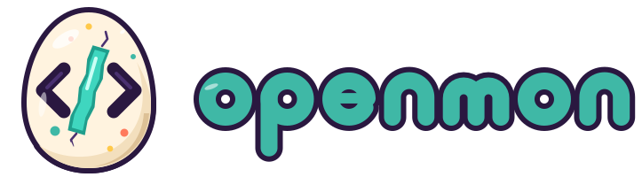

<p align="center"></p>

# Openmon

[Português](README.md) | **English**

**A desktop pet that grows from the work your AI coding agent does.**

Your Openmon lives in the corner of your screen. It reads when your agent reads, hammers when it edits, raises a shield when the tests run, and jumps up and down holding a sign when the agent **needs you**. Over days and weeks it hatches, grows and evolves into one of 18 forms (plus a hidden line few will find), decided by how your agent actually works.

- **Useful first.** You see at a glance when Claude Code is waiting for a permission, has finished, or broke something. No more coming back after 10 minutes to find the agent idle since minute two.
- **Never in the way.** Official hooks only (`async`), nothing printed, nothing blocked, no fake keystrokes. Clicks pass through everything except the pet.
- **Kind.** It never dies, never gets sick and never loses progress. Answering your agent quickly is what builds your bond.
- **Private.** No network beyond `127.0.0.1`, no telemetry, no account. Your pet is one JSON file in `~/.openmon`.

## Quick start

```bash
npm install -g openmon
openmon install   # adds hooks to ~/.claude/settings.json (a backup is kept)
openmon start     # your egg appears; drag it anywhere
openmon demo      # watch a scripted session on a throwaway egg
openmon playground # sandbox pet + control panel: every form, scene and state in minutes
```

Start a new Claude Code session and get to work. The egg hatches during your first real session.

> npm 11 may ask you to approve Electron's install script: `npm install-scripts approve electron`.

## What it shows

| Your agent | Your Openmon |
| --- | --- |
| Waits for a permission or an answer | Jumps with a **!** sign, yellow bubble with the project and the question, a soft chime. An OS notification after 20 s if you still have not looked. |
| Edits files | Hammers on a tiny anvil |
| Reads and searches | Reads a book |
| Runs shell commands | Types on a tiny terminal |
| Runs tests | Holds up a shield; sparkles when they pass |
| Browses the web or calls MCP tools | Looks through a spyglass |
| Runs subagents | Little helpers orbit it, one per subagent |
| Compacts its context | Munches |
| A tool fails | Winces, sweat drop |
| Finishes its turn | Celebrates, then shows "done ✓" until you reply |
| Nothing for 5 minutes | Falls asleep |

Several agents at once: a counter shows how many are busy, the pose follows the most urgent one, and a click on the counter opens the card with a summary of each session.

## How it grows

Every tool call your agent finishes trains one of six stats: **Craft** (edits), **Lore** (reading, search), **Shell** (commands), **Test** (test runs, green ones count triple), **Roam** (web, MCP) and **Swarm** (subagents). Agents read far more than they browse, so the lineage is picked by *weighted* affinity: rare work counts more, and every lineage is reachable.

| Stage | When | Form |
| --- | --- | --- |
| Egg | day one | |
| Sprout | 30 XP, inside your first session | |
| Juvenile | 400 XP, about a day | your top stat picks the lineage |
| Adult | 3 000 XP, about a week | top stat again (it can switch), plus a trait from your second stat |
| Mythic | 15 000 XP and bond 60, about a month | the final form, with an aura |

| Lineage | Juvenile | Adult | Mythic |
| --- | --- | --- | --- |
| Craft | Tinkit | Forgemaw | Archsmith |
| Lore | Owlet | Scrollwyrm | Oracle |
| Shell | Sparkle | Voltcrab | Kernel |
| Test | Shellby | Bastion | Aegis |
| Roam | Wisp | Skyfin | Wayfarer |
| Swarm | Mote | Hivekin | Legion |

Evolve between midnight and 5 am and it takes its **Nocturne** colours: midnight blue, moonlit belly, a crescent on the forehead.

Every egg is born with a **nature** (Brave, Sleepy, Curious, Cheerful, Calm or Cheeky) that changes how it idles and what it says, and has a **1 in 128** chance to hatch **shiny**, in rare colours that sparkle.

Evolutions play like a handheld game: *"What? Openmon is evolving!"*, the screen dims, the old and new forms flicker, then the reveal, a fanfare and the new form's own cry.

When it hatches, it asks if you want to give it a nickname. Like Pokémon, without a nickname it goes by its species name, which changes as it evolves (Tinkit, then Forgemaw). Give it a nickname from the menu (Settings → Name…) and it sticks; leave it empty to go back to the species name.

**Bond** (0 to 100) only goes up: answer your agent within 30 seconds (+2), pet it with a click (+1, five a day), come back on a new day (+1).

XP is capped at 120 per 10 minutes, so a runaway loop cannot fast-forward your pet.

### Opendex, trainer card, generations

- **Levels**: Lv 1–100 on a Pokémon-like curve (about Lv 9 at the first evolution, Lv 25 at Adult, Lv 55 at Mythic). The pet glows when an evolution is close.
- **Opendex** (`openmon dex`): 22 numbered forms with field notes, plus your badges. A **type** chart, like a Pokédex, shows what trains each type, how much each action counts, its evolution line and the power it unlocks; each form has an entry with its type and how to get it. On the card, pointing at a stat explains how to train it. Unseen forms are silhouettes, and two of them are hidden: *some say balance is the key.*
- **Trainer card** (`openmon card`): a 1200×630 image of your pet with its stats radar, ready to post.
- **Generations**: once your Openmon reaches Mythic, retire it to the **Hall of Fame** from its menu. It leaves an egg that inherits a tenth of its stats; your Opendex and badges carry over. Can you fill the whole dex?

## Everyday helpers

- **Click to answer**: when an agent waits for a permission, click the pet, its bubble, the session in its card or the OS notification, and the window that runs that agent (terminal, VS Code, the Claude app) comes to the front, ready to approve or deny. The hook finds that window once per session by walking up its own process tree; nothing is sent anywhere.
- **The card**: right-click the pet to open it, and it stays open until you close it (X, Esc or another right-click). Tabs for your agents, today's missions and stats, plus Powers, Opendex and the trainer card one click away. The gear on the card opens the settings (name, sounds, chatter, notifications, quiet mode, size), also in the tray icon.
- **Turn recap**: when an agent finishes, the bubble says what the turn did: *"shop-api is done ✓ · 3 files · 12 commands · tests ✓ · 2m 10s"*.
- **Daily gift and streak**: the first use each day gives a Snack; days in a row build a streak (🔥 on the Today tab), and every 7 days bring a Rare candy.
- **Daily missions**: three a day (the same for everyone), such as "answer your agent within 30 s, 3×" or "3 green test runs". +25 XP and bond each, +50 for a perfect day.
- **Quiet mode**: 30 minutes, 1 hour or until tomorrow, from the menu. The pet still shows everything, silently.
- **Long waits**: after two minutes waiting, one more chime and a stronger nudge; the tray icon wears a "!" while any agent waits.
- **Privacy**: tokens, passwords, API keys, Authorization headers and credentials in URLs are masked (`•••`) in bubbles, notifications and powers.
- **Size**: small, normal or large, from the menu. Settings are saved in `~/.openmon/config.json`.

## Bag: items and accessories

Like Pokémon, the **Bag** keeps what you earn by playing, and all of it carries over to the next generation.

- **Items**: *Snack* (+2 bond, one per mission), *Rare candy* (one level up right away, one per perfect day) and the *Everstone* (a gift at the first evolution: while it holds it, it does not evolve; let go whenever you like).
- **12 accessories** for the head and neck: trainer cap, party hat, beanie, headphones, flower, nightcap, wizard hat, crown, scarf, bow tie, bandana and medal. Each one comes from a feat (hatching, 50 green test runs, a perfect day, reaching Mythic…), and the Bag shows what is left. They show on the pet, in the Bag and on the trainer card.

## Your pet is never lost

New computer or a fresh Windows? Openmon keeps backups outside `~/.openmon`, in **Documents/Openmon Backups** (on Windows, the OneDrive Documents folder when there is one, already synced to the cloud). One file per day (the last 14) plus `latest.openmon.json`, refreshed every 10 minutes of use and at every evolution.

On a fresh install that finds a backup, the egg asks: *"Found your Openmon! Rex · Scrollwyrm · Lv 33 · Bring it back"*. One click and it is back, with its Opendex, badges and Hall of Fame.

From the menu (Settings → Backups) you can save now, export to a file, import a save and open the folder. In a terminal: `openmon backup [file]` and `openmon restore <file|latest>`.

## Powers: what your Openmon is good for

Each lineage your Openmon grows into unlocks a **power**, for good (the Opendex remembers across generations). Open them from the ⚡ button on the stats card or the menu.

| Power | Unlocked by | Shows, per agent session |
| --- | --- | --- |
| Forge log | Craft | every file changed, edits, lines added and removed |
| Reading list | Lore | files read and searches made, so you see where it is looking |
| Command log | Shell | each command, ✓ or ✗, how long it took, one click to copy |
| Test tracker | Test | each test run with its summary line, the green streak |
| Travel log | Roam | pages fetched, web searches, MCP tools |
| Hive view | Swarm | subagents, still running or done, and their time |

Above the powers sits the **Journal**: a chart of the last 14 days of what your agents did by kind of work, each day's projects and, for the last week, tool calls, turns, % of green test runs, time waiting for you and the busiest project. It keeps 60 days and goes into the backups.

Everyone also gets the **waiting counter**: how long your agents sat waiting for you today, your fastest answer, and a live timer in the "needs you" bubble. It is the number a good pet helps you shrink.

All of it stays in memory on your machine; nothing is written to disk or sent anywhere.

## Try everything now: the Playground

Raising a Mythic takes weeks. `openmon playground` opens a second, sandbox pet (its own save in `~/.openmon-playground`, port 4748) next to yours, plus a control panel: hatch and evolve into any of the 22 forms with the real scene, shiny and Nocturne on/off, the hidden Chimera with any pair, every agent state (editing, tests passing or failing, subagents, "needs you" from one or two agents), level-ups, bond, natures, badges, Hall of Fame, English/Portuguese. Close the panel to end it. `--serve` runs it in a browser instead.

## Commands

```
openmon install      add hooks to ~/.claude/settings.json (a backup is kept)
openmon start        open the pet
openmon demo         scripted session on a throwaway egg
openmon stats        your pet in the terminal
openmon name <nickname>  give it a nickname (--clear goes back to the species name)
openmon dex          open the Opendex
openmon card         open your trainer card
openmon backup [file]      save a backup now (or export to a file)
openmon restore <file|latest>  bring back a pet from a backup
openmon stop         put your pet away
openmon autostart on open the pet when you log in (off / status too)
openmon art          art pack folder and file names (see docs/ART-PACKS.md)
openmon serve        daemon only: open http://127.0.0.1:4747/ in a browser, or add it to OBS
openmon codex        print the line that connects Codex CLI
openmon status       daemon and hooks status
openmon uninstall    remove the hooks (your pet is kept)
```

`--settings .claude/settings.json` installs for a single project. `OPENMON_PORT` and `OPENMON_HOME` change the port and the data folder.

On the pet: **click** to pet it (or, while an agent waits for you, to jump to that agent's window), **drag** to move, **right-click** to open or close the card; the card's **gear** and the tray icon open the menu (name, Opendex, trainer card, sounds, chatter, notifications, start with the computer, demo, quit). Its eyes follow your cursor.

Only permission prompts and questions raise the alarm, with at most one chime every 20 s. "Waiting for your input" after a finished turn just shows "done ✓".

## Languages and art

- English and Brazilian Portuguese, picked from your system language (or `?lang=pt-BR` in a browser). Form names stay the same in every language.
- **Official art**: all 22 Openmons ship as vector art (`art/official`); `OPENMON_CLASSIC=1` brings back the art drawn in code.
- **Art packs**: drop images named after forms (`craft-adult.png`, `craft-adult.shiny@sleep.svg`…) into `~/.openmon/art` and they replace the built-in art, with motion, props and effects still applied. Guide for artists: [docs/ART-PACKS.md](docs/ART-PACKS.md).

## Other agents

- **Codex CLI**: `openmon codex` prints a `notify = [...]` line for `~/.codex/config.toml`. Codex only reports finished turns today, so the pet celebrates and levels up, but cannot show tools.
- **Anything else**: POST a signal to `http://127.0.0.1:4747/event`:
  `{"_agent":"signal","session":"my-agent","kind":"tool-done","family":"craft"}`.
  Kinds and families are listed in [`src/classify.js`](src/classify.js).

## How it works

```
Claude Code ──hook (async)──▶ src/hook.js ──POST /event──▶ daemon (127.0.0.1:4747)
                                                             │ classify → sessions → pet engine
                                                             ▼                       │
                                     pet window / browser / OBS ◀── SSE /stream      └─▶ ~/.openmon/pet.json
```

- [`classify.js`](src/classify.js): hook payload to a small signal. One function per agent.
- [`sessions.js`](src/sessions.js): live state per session, and the one pose that matters most.
- [`pet.js`](src/pet.js): XP, stats, bond, evolution and achievements, as pure functions.
- [`species.js`](src/species.js): every stage, lineage and name as data.
- [`public/art.js`](public/art.js): draws the official vector art (`art/official`), with every form also drawn in code as a fallback.
- [`src/focus.js`](src/focus.js): finds and raises the window an agent runs in, for "click to answer".

`openmon start` runs the pet under a small supervisor: if the pet ever dies without being told to quit (a crashed GPU or network process can do that on some machines), it is back within two seconds, and the restart is noted in `~/.openmon/error.log`.

The daemon only listens on `127.0.0.1` and refuses requests from other web pages (Origin and Host checks), so a website cannot feed or spy on your pet. The hook always exits 0 and prints nothing. It gives up after 1.5 s, or 4.5 s on the one event per session where it looks up its agent's window (hooks run async, so the agent never waits).

Product design, principles and roadmap: [docs/DESIGN.md](docs/DESIGN.md).

## Develop

```bash
npm install
npm test          # node:test, no extra dependencies
npm run smoke     # loads every page in hidden Electron windows, fails on any console error
npm run serve     # then open http://127.0.0.1:4747/?preview
npm start         # the desktop pet
```

## License

MIT
