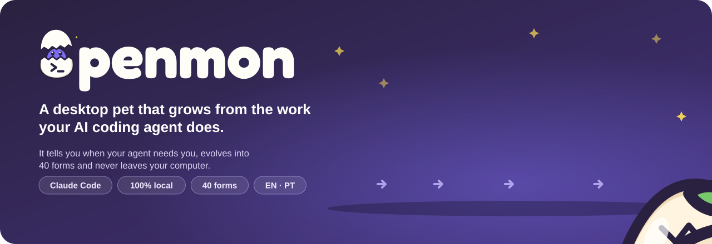
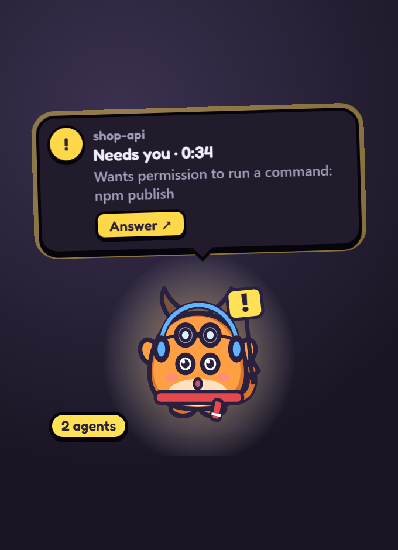
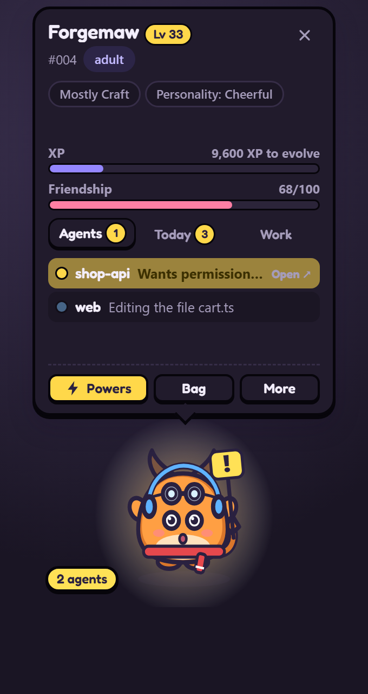

# Openmon

[Português](README.md) | **English** | [Español](README.es.md)

**Your AI agent works. A little creature in the corner of your screen shows what it is doing, tells you when it needs you, and grows with every task.**




## What it does for you

* **Tells you when your agent needs you.** A permission or a question: it jumps with a sign, shows the project and the request in plain words ("Wants permission to run a command: npm publish") and plays a soft chime. If you do not look, a notification follows.
* **Takes you to the agent in one click.** A click on the pet, its bubble or the notification brings the window your agent runs in to the front: a terminal, VS Code or the Claude app.
* **Sums up every task.** When the agent finishes: "shop-api is done ✓ · 3 files · 12 commands · tests ✓ · 2m 10s".

## Install in 3 steps

1. Download the installer from [Releases](https://github.com/tiagocardosobezerra/openmon/releases/latest): Windows `.exe`, macOS `.dmg` (Apple Silicon) or Linux `.AppImage`.
2. Open Openmon and click **Connect** on the egg's bubble. This connects Claude Code.
3. Choose your first Openmon: Tinkit (edits), Owlet (reading and search) or Sparkle (commands). Then start a new Claude Code conversation and work as usual: the egg hatches during your first session.

The agent notices run with [Node.js](https://nodejs.org), which Claude Code users already have. The installers are not signed yet: on Windows, click "More info → Run anyway"; on macOS, right-click the app and choose "Open". Prefer the source? See [Install from source](#install-from-source).

**Privacy:** everything stays on your computer, with no account. Its only trip to the internet is once a day, to check GitHub for a new version (you can turn it off); phone alerts and GitHub are optional.

Behind it there is a game: the egg hatches, grows and evolves into one of 39 forms, shaped by your agent's work. Types, items, accessories, legendaries, skills and missions are in [docs/GAME.en.md](docs/GAME.en.md).

## Your personal assistant: talk to Claude without opening Claude

`Ctrl+Alt+C` (or **More → Talk to Claude**, or the tray icon) opens Openmon's chat. It runs your own Claude Code, with your login, your settings, your connectors (MCP) and your `CLAUDE.md`. No API key needed.

* **Real conversations:** the answer shows while it is written, with one line per tool used ("Write: list.txt", "Bash: npm test"). Pick each conversation's folder: a project, or the **Assistant** folder (Documents/Openmon Assistant) for general things.
* **Requests inside the chat:** when Claude needs permission, the request shows in the chat with the change, and also in the pet's bubble, the notification and the shortcuts. Nothing is ever approved on its own.
* **Conversations open elsewhere:** the ones in the terminal or the editor are in the list, read live. You can write to them, or **Continue here**.
* **Quick actions:** "What do I have today?", "Explain what I copied", "Review my changes", "Run the tests" and your own. `{clipboard}` becomes what you copied.
* **Files and pictures:** drop them on the window, attach them with the clip, or paste a screenshot. Pictures go to Claude to see.
* **Reminders and tasks:** "in 30 minutes", "today at 3 pm", "every day at 9" or "weekdays at 9". A reminder makes the pet tell you; a task makes Claude work at that time, and the pet tells you when it is done.
* **Assistant memory:** the assistant folder's `CLAUDE.md`, with what Claude should always know about you, editable from the chat.
* **From your phone (optional):** with phone alerts on, what you send to the `<your topic>-in` topic in the ntfy app reaches the agent that waits for you, or your latest conversation.
* **Estimated cost** of each conversation at API list prices. On a monthly plan (Pro, Max, Team) the chat says "included in your Claude plan".
* **The assistant is your Openmon:** it answers with your pet's name and manner, and the answer shows in the bubble. In Settings → Pet, the pet can read answers aloud (your computer's voices, no internet).
* **Quick question** (`Ctrl+Alt+A`): a small box next to the pet; Enter, and the answer comes back in the bubble. `Ctrl+Alt+S` does the same with a picture of your screen ("what is this error?"). You can also send what you copied.
* **Claude acts in Openmon:** "remind me at 3 pm to call John", "every Monday give me a summary of the week", "remember that I like bullet points". It sets reminders and tasks, saves facts in its memory, speaks through the bubble, sends notifications and reads what your agents did (Openmon's tools, which never ask for permission).
* **Ready-made routines** in Reminders and tasks: a morning brief and an end-of-day summary, on weekdays.
* **Organized:** pick each conversation's model (Haiku, Sonnet, Opus), pin conversations, search them all and export one as Markdown. On each answer: **Listen** and **Remember**.

## More it does

* **Lets you answer and talk to your agent right there.** With Claude Code, the bubble gets **Allow** and **Deny** on permission requests and the options of each question the agent asks; **Message** writes to the conversation the pet follows, and reaches an idle agent right away. Claude Code waits for your answer on the pet for up to 25 seconds; after that it asks you as usual. Nothing is ever approved on its own: only your click answers. Turn it off in Settings → "Answer from the pet".
* **Shows what is happening, without watching the terminal.** A hammer is editing, a book reading, a shield testing, a spyglass the web. Several agents at once? The card lists each one and what it is doing.
* **Keeps a journal.** What your agents did each day, by kind of work and by project, and how long they waited for you.
* **Never in the way, never leaves your computer.** Clicks pass through its window, it never blocks or slows the agent, uses no account and sends nothing of yours to the internet (it only checks once a day for a new version; phone alerts and GitHub are yours to turn on), and passwords and keys show hidden (`•••`).
* **Never lost.** It keeps copies in Documents/Openmon Backups. New computer? On a fresh install it offers to bring your pet back.
* **Comes with you to another computer (optional).** Sign in with GitHub (`openmon login` or Settings → Computer) and your pet is saved in a secret Gist in your account. On another computer, sign in with the same account and it picks up where you left off. If it changed on both, Openmon asks which one to keep. No Openmon server: the app talks straight to GitHub.

## What it looks like

> **You:** fix the checkout tests
>
> **Claude:** reads the files, edits two of them and asks to run `npm publish`.
>
> **Openmon:** reads a book, picks up the hammer, raises the shield… and jumps with the sign: **"shop-api needs you · Wants permission to run a command: npm publish"**. You click it, the Claude window appears, you approve. It celebrates: **"All done! · 2 files · tests ✓"**, and gains experience.

<table>
<tr>
<td width="50%" align="center"><br><sub>When your agent needs you</sub></td>
<td width="50%" align="center"><br><sub>Right-click: the card with your agents</sub></td>
</tr>
</table>

| What it does | What it means |
|---|---|
| Jumps holding the **!** sign | The agent waits for your permission or answer. Click it to go there |
| Hammer, book, terminal, shield, spyglass | The agent is editing, reading, running commands, testing or on the web |
| Little helpers flying around | The agent called other agents to help |
| Celebrates | The agent finished: your turn |
| Winces | Something failed, like a test |
| Sleeps | Nothing has happened for a few minutes |

## Install from source

You need [Node.js](https://nodejs.org) 22.12 or newer and [Claude Code](https://claude.com/claude-code).

### 1. Install

```bash
git clone https://github.com/tiagocardosobezerra/openmon.git
cd openmon
npm install
npm link
```

`npm link` creates the `openmon` command. The first time the pet opens, Electron downloads its own program (about 100 MB).

### 2. Connect Claude Code

```bash
openmon install
```

Adds the notices (hooks) to `~/.claude/settings.json` and keeps a backup. For one project only: `openmon install --settings .claude/settings.json`. Forgot? The egg itself shows a **Connect** button.

### 3. Call your Openmon

```bash
openmon start
```

The egg appears in the corner of your screen and an icon shows up in the tray. Start a new Claude Code conversation and work as usual: it hatches during your first session. Want to see it first? `openmon demo`.

| Command | What it does |
|---|---|
| `openmon start` / `openmon stop` | Opens or puts away the pet |
| `openmon install` / `openmon uninstall` | Turns the Claude Code notices on or off (your pet is kept) |
| `openmon demo` | Plays a sample session on a throwaway egg |
| `openmon playground` | A test pet with a control panel: every form and scene in minutes |
| `openmon dex` / `openmon card` | Opens the Opendex or the trainer card |
| `openmon name <nickname>` | Gives it a nickname (`--clear` goes back to the species name) |
| `openmon backup [file]` / `openmon restore <file\|latest>` | Makes a copy or brings a pet back |
| `openmon login` / `openmon sync` / `openmon logout` | Carries your pet between computers through your GitHub account |
| `openmon install --agent gemini\|cursor\|opencode\|aider` | Connects Openmon to Gemini CLI, Cursor, OpenCode or Aider |
| `openmon autostart on\|off` | Opens the pet when you turn on the computer |
| `openmon stats` / `openmon status` | The pet in your terminal / whether everything is on |

## Everyday utilities

**Alerts that save time**
* **Looks stuck**: mid-task, no tool running and nothing happening for 4 minutes. One click takes you to the agent.
* **Still running**: a command (tests, a build) running for more than 8 minutes.
* **In a loop**: the same failure 3 times in a row.
* **Dangerous command**: `rm -rf`, `git push --force`, `git reset --hard`, `DROP TABLE`, `curl … | sh` and the like turn the permission request **red**.
* **Commit**: 30 edits in 45 minutes without a commit get a gentle reminder.
* **Long conversation**: it tells you when Claude summarizes the conversation to keep going.
* **Tests green again**: a cheer when tests that were failing pass again.

**Answer without leaving what you are doing**
* **Allow, Always allow and Deny** on the bubble. "Always allow" applies the rule Claude Code itself suggests for that request. **Explain…** denies with a reason the agent reads (or denies and stops the agent).
* **The agent's questions**: their options become buttons on the bubble; **Other…** opens a small window to write your own answer.
* **Message to the conversation**: on the "All done!" bubble or in the card, **Message** opens a small window. An idle agent wakes up right away; a working one gets it with its next step.
* **Open** hands the question or request to the agent's window at once, without waiting for the pet.
* **See all**: the bubble shows the start of the change; **See all** opens a page with the whole change. There, `Y` allows and `N` denies.
* **From the system notification**: if you don't look at the pet, the notification comes with **Allow** and **Deny**.
* **Pause all agents**: in the **More** panel, one button asks every working conversation to stop and wait for you.
* **Claude Code permission rules** in Settings → Computer, one switch each: read and search without asking, run the tests without asking, and always ask before deleting or publishing.
* **Several agents waiting?** The card shows the buttons under each one.
* **Shortcuts**: `Ctrl+Alt+O` opens the card, `Ctrl+Alt+J` takes you to the agent that waits, `Ctrl+Alt+C` opens the chat with Claude, `Ctrl+Alt+A` asks a quick question and `Ctrl+Alt+S` asks about your screen.

**Numbers about your work**
* **Tokens** used today (on the card) and per day (in the Journal), read from Claude Code's own conversation files, on your computer.
* **Estimated cost** in dollars per project and over the last 7 days, at Anthropic API list prices. It is an estimate: monthly plans (Pro, Max, Team) are not charged per token.
* **Today's requests**: every permission asked that day, how it was answered (on the pet, in the agent or not at all) and the change that came with it.
* **Yesterday in one line** on the first use of the day.
* **Stand-up text**: a Journal button copies "last working day" and "today", ready to paste.
* **Hours per project (CSV)**: your agent's working time per project and day, for timesheets.
* **Timeline** of each session and a **search** across all of them ("which session touched cart.ts?").

**For your day**
* **Focus mode** (25, 50 or 90 minutes): only "needs you" gets through; at the end, a break suggestion.
* **Break reminder** after 50 or 90 minutes of work in a row.
* **Steps aside in full screen**: with a game, a video or a presentation in full screen, the pets hide and come back when it ends (Windows and macOS; you can turn it off in Settings → Pet).
* **First steps**: in the Opendex, a list shows what is left to get started (connect, first session, pick a starter…) until it is all done.
* **New version**: when one comes out, the pet tells you and the tray icon gets **Download**.
* **Presentation mode**: project names become "Project A, B…" and commands are hidden everywhere Openmon shows them, for screen sharing.
* **Phone alerts** (optional, through the free ntfy app): if an agent waits for a while, your phone gets a notice. It only sends "Your agent needs you".
* **In OBS**: the pet with a transparent background for streams (address on the Settings page).

## Going further

### Settings

Right-click the pet and click **More** at the bottom of its card (or the tray icon). The menu has the card, the pages, **focus mode**, **quiet mode** and **Settings**, a page with six sections:

* **Pet**: nickname, size, language, sounds, chatter, walking around and sharing conversations among the Openmons on screen.
* **Alerts**: system notification and answering permissions from the pet (with the waiting time).
* **Focus and calm**: focus mode, quiet mode, presentation mode and break reminder.
* **Phone**: phone alerts through the ntfy app (optional).
* **Computer**: start with the computer, connect Claude Code and other agents, Claude Code permission rules, check for a new version, your pet on any computer (GitHub account), copies of your pet (make one now, export, bring back from a file) and putting the pet back in its corner.
* **Advanced**: keyboard shortcuts, OBS and the demo.

### Your own art

The 39 forms ship as official vector art (`art/official`), with poses and shiny versions. To replace them, put images named after the form (`craft-adult.png`, `craft-adult.shiny@sleep.svg`…) in `~/.openmon/art`. The guide is [docs/ART-PACKS.md](docs/ART-PACKS.md). `OPENMON_CLASSIC=1` brings back the art drawn in code.

### Other agents

* **Gemini CLI**: `openmon install --agent gemini`. Shows tools, tests, finished tasks and permission prompts.
* **Cursor**: `openmon install --agent cursor`. Shows tools, tests and finished tasks (Cursor does not report when it waits for you).
* **OpenCode**: `openmon install --agent opencode` installs a plugin that shows tools, finished tasks and permission prompts.
* **Aider**: `openmon install --agent aider` prints the command to start Aider with a "your turn" notice.
* **Codex CLI**: `openmon codex` prints the line to paste into `~/.codex/config.toml`. Codex only reports finished tasks, so the pet celebrates and grows but cannot show tools.
* **Anything else**: POST `{"_agent":"signal","session":"my-agent","kind":"tool-done","family":"craft"}` to `http://127.0.0.1:4747/event`. Kinds are listed in [`src/classify.js`](src/classify.js).

<details>
<summary><strong>How it works inside</strong></summary>

```
Claude Code ──hook (async)──▶ src/hook.js ──POST /event──▶ daemon (127.0.0.1:4747)
                                                             │ classify → sessions → pet
                                                             ▼                       │
                                     pet window / browser / OBS ◀── SSE /stream      └─▶ ~/.openmon/pet.json
```

* [`classify.js`](src/classify.js): turns the agent's notice into a small signal.
* [`sessions.js`](src/sessions.js): the state of each conversation and the one pose that matters most.
* [`pet.js`](src/pet.js): XP, friendship, evolution, missions, items and accessories, as pure functions.
* [`focus.js`](src/focus.js): finds the agent's window and brings it to the front.
* [`backup.js`](src/backup.js): the copies in Documents and the way back on a fresh install.
* [`public/art.js`](public/art.js): draws the official art, with blinking eyes and accessories in the right place.

The server only listens on `127.0.0.1` and refuses requests from other web pages (Origin and Host checks). The hook never prints, always exits 0 and gives up within 1.5 s. `openmon start` runs the pet under a supervisor that brings it back within two seconds if it ever falls over.

</details>

## How it works inside



1. **The agent reports.** Claude Code, Gemini CLI, Cursor, OpenCode and Aider already report every step they take (hooks). Openmon only listens and never blocks anything.
2. **It becomes a signal.** A local server at `127.0.0.1:4747` turns each notice into a simple signal: a tool used, a green or red test, "needs you".
3. **The pet decides.** It picks a pose, earns experience in the right kind of work and logs what the agent did in its Skills.
4. **It shows up on screen.** Everything stays in the corner of your screen. Nothing of yours leaves your computer; it only checks once a day for a new version (phone alerts and GitHub are optional: one only sends "Your agent needs you", the other keeps your pet in a secret Gist in your account).

## Develop

```bash
npm install
npm test          # node:test, no extra dependencies
npm run smoke     # opens every page in hidden Electron windows and fails on any error
npm run serve     # then open http://127.0.0.1:4747/?preview
npm start         # the desktop pet
```

Design, principles and what comes next: [docs/DESIGN.md](docs/DESIGN.md). Review history: [docs/REVIEW-LOG.md](docs/REVIEW-LOG.md).

## License

MIT. Openmon is an independent project, with original creatures and art.
