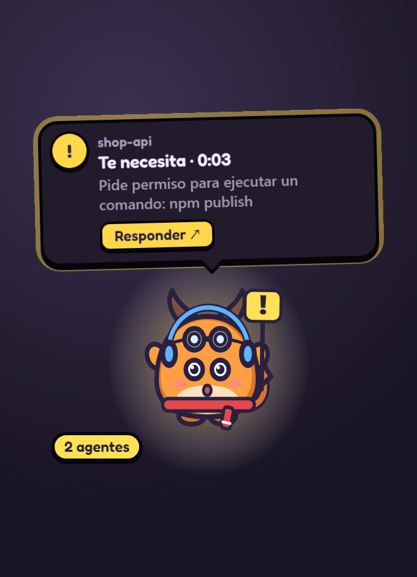
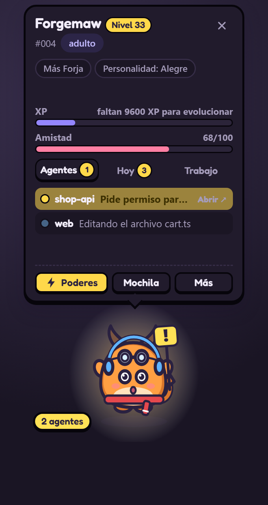

# Openmon

[Português](README.md) | [English](README.en.md) | **Español**

**Tu agente de IA trabaja. Una criatura en la esquina de la pantalla muestra lo que está haciendo, te avisa cuando te necesita y crece con cada tarea.**




## Lo que hace por ti

* **Te avisa cuando el agente te necesita.** Pedido de permiso o pregunta: salta con un cartel, muestra el proyecto y el pedido en palabras simples ("Pide permiso para ejecutar un comando: npm publish") y suena un aviso suave. Si no miras, llega una notificación.
* **Te lleva al agente con un clic.** Un clic en la mascota, en el globo o en la notificación trae al frente la ventana donde corre el agente: terminal, VS Code o la app de Claude.
* **Resume cada tarea.** Cuando el agente termina: "shop-api terminó ✓ · 3 archivos · 12 comandos · pruebas ✓ · 2m 10s".

## Instala en 3 pasos

1. Descarga el instalador en [Releases](https://github.com/tiagocardosobezerra/openmon/releases/latest): Windows `.exe`, macOS `.dmg` (Apple Silicon) o Linux `.AppImage`.
2. Abre Openmon y haz clic en **Conectar** en el globo del huevo. Así se conecta Claude Code.
3. Elige tu primer Openmon: Tinkit (ediciones), Owlet (lectura y búsqueda) o Sparkle (comandos). Después abre una conversación nueva en Claude Code y trabaja normalmente: el huevo eclosiona durante tu primera sesión.

Los avisos del agente corren con [Node.js](https://nodejs.org), que quien usa Claude Code ya tiene. Los instaladores aún no están firmados: en Windows, haz clic en "Más información → Ejecutar de todas formas"; en macOS, clic derecho en la app y "Abrir". ¿Prefieres el código? Mira [Instalar desde el código](#instalar-desde-el-código).

**Privacidad:** todo queda en tu computadora, sin cuenta. Su única salida a internet es una vez al día, para ver en GitHub si hay una versión nueva (se puede apagar); el aviso en el celular y GitHub son opcionales.

Detrás hay un juego: el huevo eclosiona, crece y evoluciona a una de 39 formas según el trabajo del agente. Tipos, objetos, accesorios, legendarios, habilidades y misiones están en [docs/GAME.es.md](docs/GAME.es.md).

## Más de lo que hace

* **Te deja responder y hablar con el agente ahí mismo.** Con Claude Code, el globo gana **Permitir** y **Rechazar** en los pedidos de permiso y las opciones de cada pregunta del agente; **Mensaje** escribe a la conversación que sigue la mascota, y llega enseguida si el agente está parado. Claude Code espera tu respuesta en la mascota hasta 25 segundos; después pregunta como siempre. Nada se aprueba solo: solo tu clic responde. Se desactiva en Configuración → "Responder desde la mascota".
* **Muestra lo que pasa, sin mirar la terminal.** Martillo es editar, libro es leer, escudo es probar, catalejo es web. ¿Varios agentes a la vez? La tarjeta lista cada uno, con lo que está haciendo.
* **Lleva un diario.** Lo que hicieron tus agentes cada día, por tipo de trabajo y por proyecto, y cuánto tiempo te esperaron.
* **No molesta y no sale de tu computadora.** Los clics atraviesan la ventana, nunca bloquea ni retrasa al agente, no usa cuenta ni manda nada tuyo a internet (solo revisa una vez al día si hay versión nueva; el aviso en el celular y GitHub los activas si quieres), y las contraseñas y claves aparecen ocultas (`•••`).
* **No se pierde.** Hace copias en Documentos/Openmon Backups. ¿Formateaste la PC? En una instalación nueva pregunta si quieres traerla de vuelta.
* **Va contigo a otra computadora (opcional).** Inicia sesión con GitHub (`openmon login` o Ajustes → Computadora) y tu mascota queda guardada en un Gist secreto de tu cuenta. En otra computadora, inicia sesión con la misma cuenta y sigue donde la dejaste. Si cambió en las dos, Openmon pregunta cuál conservar. Sin servidor de Openmon: la app habla directo con GitHub.

## Cómo se ve en la práctica

> **Tú:** arregla las pruebas del checkout
>
> **Claude:** lee los archivos, edita dos y pide ejecutar `npm publish`.
>
> **Openmon:** lee un libro, toma el martillo, levanta el escudo… y salta con el cartel: **"shop-api te necesita · Pide permiso para ejecutar un comando: npm publish"**. Haces clic en ella, aparece la ventana de Claude, apruebas. Celebra: **"¡Terminó! · 2 archivos · pruebas ✓"**, y gana experiencia.

<table>
<tr>
<td width="50%" align="center"><br><sub>Cuando el agente te necesita</sub></td>
<td width="50%" align="center"><br><sub>Clic derecho: la tarjeta con tus agentes</sub></td>
</tr>
</table>

| Lo que hace | Lo que significa |
|---|---|
| Salta con el cartel **!** | El agente espera tu permiso o respuesta. Haz clic en ella para ir allí |
| Martillo, libro, terminal, escudo, catalejo | El agente está editando, leyendo, ejecutando comandos, probando o en la web |
| Ayudantes volando alrededor | El agente llamó a otros agentes para ayudar |
| Celebra | El agente terminó: te toca |
| Hace una mueca | Algo falló, como una prueba |
| Duerme | No pasa nada desde hace unos minutos |

## Instalar desde el código

Necesitas [Node.js](https://nodejs.org) 22.12 o más nuevo y [Claude Code](https://claude.com/claude-code).

### 1. Instala

```bash
git clone https://github.com/tiagocardosobezerra/openmon.git
cd openmon
npm install
npm link
```

`npm link` crea el comando `openmon`. La primera vez que la mascota se abre, Electron descarga su propio programa (unos 100 MB).

### 2. Conéctalo a Claude Code

```bash
openmon install
```

Agrega los avisos (hooks) en `~/.claude/settings.json` y guarda una copia de seguridad. Solo para un proyecto: `openmon install --settings .claude/settings.json`. ¿Lo olvidaste? El propio huevo muestra un botón **Conectar**.

### 3. Llama a tu Openmon

```bash
openmon start
```

El huevo aparece en la esquina de la pantalla y un ícono en la bandeja. Abre una conversación nueva en Claude Code y trabaja normalmente: eclosiona durante tu primera sesión. ¿Quieres verlo antes? `openmon demo`.

| Comando | Qué hace |
|---|---|
| `openmon start` / `openmon stop` | Abre o guarda la mascota |
| `openmon install` / `openmon uninstall` | Activa o desactiva los avisos de Claude Code (tu mascota queda guardada) |
| `openmon demo` | Muestra una sesión de ejemplo en un huevo desechable |
| `openmon playground` | Una mascota de pruebas con panel: mira todas las formas y escenas en minutos |
| `openmon dex` / `openmon card` | Abre la Opendex o la tarjeta de entrenador |
| `openmon name <apodo>` | Pone un apodo (`--clear` vuelve al nombre de la especie) |
| `openmon backup [archivo]` / `openmon restore <archivo\|latest>` | Hace una copia o trae una mascota de vuelta |
| `openmon login` / `openmon sync` / `openmon logout` | Lleva tu mascota entre computadoras con tu cuenta de GitHub |
| `openmon install --agent gemini\|cursor\|opencode\|aider` | Conecta Openmon a Gemini CLI, Cursor, OpenCode o Aider |
| `openmon autostart on\|off` | Abre la mascota al encender la computadora |
| `openmon stats` / `openmon status` | La mascota en la terminal / si todo está conectado |

## Utilidades del día a día

**Avisos que ahorran tiempo**
* **Parece trabado**: en medio de una tarea, sin ninguna herramienta corriendo y sin nada nuevo desde hace 4 minutos. Un clic te lleva al agente.
* **Sigue corriendo**: un comando (pruebas, build) que corre hace más de 8 minutos.
* **En bucle**: la misma falla 3 veces seguidas.
* **Comando peligroso**: `rm -rf`, `git push --force`, `git reset --hard`, `DROP TABLE`, `curl … | sh` y parecidos ponen el pedido de permiso en **rojo**.
* **Commit**: 30 ediciones en 45 minutos sin commit ganan un recordatorio amable.
* **Conversación larga**: avisa cuando Claude resume la conversación para seguir.
* **Pruebas de vuelta en verde**: celebra cuando pruebas que fallaban vuelven a pasar.

**Responder sin dejar lo que haces**
* **Permitir, Permitir siempre y Rechazar** en el globo. "Permitir siempre" aplica la regla que el propio Claude Code sugiere para ese pedido. **Explicar…** rechaza con un motivo que el agente lee (o rechaza y detiene al agente).
* **Preguntas del agente**: sus opciones se vuelven botones en el globo; **Otra…** abre una ventanita para escribir tu respuesta.
* **Mensaje a la conversación**: en el globo de "¡Terminó!" o en la tarjeta, **Mensaje** abre una ventanita. Un agente parado despierta enseguida; uno trabajando lo recibe con su próximo paso.
* **Abrir** pasa la pregunta o el pedido a la ventana del agente enseguida, sin esperar a la mascota.
* **Ver todo**: la burbuja muestra el comienzo del cambio; **Ver todo** abre una página con el cambio entero. Ahí, `Y` permite y `N` rechaza.
* **Desde la notificación del sistema**: si no miras la mascota, la notificación llega con **Permitir** y **Rechazar**.
* **Pausar todos los agentes**: en el panel **Más**, un botón pide a todas las conversaciones que trabajan que paren y te esperen.
* **Reglas de permiso de Claude Code** en Configuración → Computadora, un interruptor cada una: leer y buscar sin preguntar, correr las pruebas sin preguntar, y preguntar siempre antes de borrar o publicar.
* **¿Varios agentes esperando?** La tarjeta muestra los botones debajo de cada uno.
* **Atajos**: `Ctrl+Alt+O` abre la tarjeta, `Ctrl+Alt+J` te lleva al agente que espera.

**Números de tu trabajo**
* **Tokens** usados hoy (en la tarjeta) y por día (en el Diario), leídos de los archivos de conversación del propio Claude Code, en tu computadora.
* **Costo estimado** en dólares por proyecto y en los últimos 7 días, con los precios de lista de la API de Anthropic. Es una estimación: los planes mensuales (Pro, Max, Team) no pagan por token.
* **Pedidos de hoy**: cada permiso pedido en el día, cómo se respondió (en la mascota, en el agente o sin respuesta) y el cambio que traía.
* **Ayer en una línea** en el primer uso del día.
* **Texto para la daily**: un botón en el Diario copia "último día de trabajo" y "hoy" listos para pegar.
* **Horas por proyecto (CSV)**: tiempo de trabajo del agente por proyecto y día, para tu hoja de horas.
* **Línea de tiempo** de cada sesión y **búsqueda** en todas ("¿en qué sesión tocó el agente cart.ts?").

**Para tu día**
* **Modo foco** (25, 50 o 90 minutos): solo aparece "te necesita"; al final, una sugerencia de pausa.
* **Recordatorio de pausa** después de 50 o 90 minutos seguidos de trabajo.
* **Se aparta en pantalla completa**: con un juego, un video o una presentación en pantalla completa, las mascotas se esconden y vuelven cuando termina (Windows y macOS; se puede apagar en Configuración → Mascota).
* **Primeros pasos**: en la Opendex, una lista muestra lo que falta para empezar (conectar, primera sesión, elegir el inicial…) hasta que todo esté hecho.
* **Versión nueva**: cuando sale una, la mascota avisa y el ícono de la bandeja muestra **Descargar**.
* **Modo presentación**: cambia los nombres de proyecto por "Proyecto A, B…" y oculta los comandos en todo lo que muestra Openmon, para compartir pantalla.
* **Aviso en el celular** (opcional, con la app gratuita ntfy): si un agente espera desde hace un rato, llega un aviso. Solo envía "Tu agente te necesita".
* **En OBS**: la mascota con fondo transparente para transmisiones (la dirección está en la página de Configuración).

## Para ir más allá

### Configuración

Haz clic derecho en la mascota y en **Más**, al pie de la tarjeta (o en el ícono de la bandeja). El menú tiene la tarjeta, las páginas, el **modo foco**, el **modo silencio** y la **Configuración**, una página con seis secciones:

* **Mascota**: apodo, tamaño, idioma, sonidos, frases, pasear por la pantalla y repartir las conversaciones entre los Openmons en pantalla.
* **Avisos**: notificación del sistema y responder permisos desde la mascota (con el tiempo de espera).
* **Foco y calma**: modo foco, modo silencio, modo presentación y recordatorio de pausa.
* **Celular**: aviso en el celular con la app ntfy (opcional).
* **Computadora**: iniciar con la computadora, conectar Claude Code y otros agentes, reglas de permiso de Claude Code, buscar versión nueva, tu mascota en cualquier computadora (cuenta de GitHub), copias de la mascota (hacer ahora, exportar, traer de un archivo) y devolver la mascota a la esquina.
* **Avanzado**: atajos de teclado, OBS y demostración.

### Tu arte

Las 39 formas vienen en arte vectorial oficial (`art/official`), con poses y versiones brillantes. Para cambiarlas, pon imágenes con el nombre de la forma (`craft-adult.png`, `craft-adult.shiny@sleep.svg`…) en `~/.openmon/art`. La guía está en [docs/ART-PACKS.md](docs/ART-PACKS.md). `OPENMON_CLASSIC=1` vuelve al arte dibujado en código.

### Otros agentes

* **Gemini CLI**: `openmon install --agent gemini`. Muestra herramientas, pruebas, fin de tarea y pedidos de permiso.
* **Cursor**: `openmon install --agent cursor`. Muestra herramientas, pruebas y fin de tarea (Cursor no avisa cuando te espera).
* **OpenCode**: `openmon install --agent opencode` instala un plugin que muestra herramientas, fin de tarea y pedidos de permiso.
* **Aider**: `openmon install --agent aider` muestra el comando para iniciar Aider con el aviso de "te toca".
* **Codex CLI**: `openmon codex` muestra la línea para pegar en `~/.codex/config.toml`. Codex solo avisa las tareas terminadas, así que la mascota celebra y crece, pero no muestra las herramientas.
* **Cualquier otro**: envía un POST a `http://127.0.0.1:4747/event` con `{"_agent":"signal","session":"mi-agente","kind":"tool-done","family":"craft"}`. Los tipos están en [`src/classify.js`](src/classify.js).

<details>
<summary><strong>Cómo funciona por dentro (código)</strong></summary>

```
Claude Code ──hook (async)──▶ src/hook.js ──POST /event──▶ daemon (127.0.0.1:4747)
                                                             │ classify → sessions → pet
                                                             ▼                       │
                               ventana de la mascota / navegador / OBS ◀── SSE /stream └─▶ ~/.openmon/pet.json
```

* [`classify.js`](src/classify.js): convierte el aviso del agente en una señal pequeña.
* [`sessions.js`](src/sessions.js): el estado de cada conversación y la pose que más importa.
* [`pet.js`](src/pet.js): XP, amistad, evolución, misiones, objetos y accesorios, como funciones puras.
* [`focus.js`](src/focus.js): encuentra la ventana del agente y la trae al frente.
* [`backup.js`](src/backup.js): las copias en Documentos y la vuelta en una instalación nueva.
* [`public/art.js`](public/art.js): dibuja el arte oficial, con ojos que parpadean y accesorios en su lugar.

El servidor solo escucha en `127.0.0.1` y rechaza pedidos de otras páginas web (verificación de Origin y Host). El hook nunca imprime nada, siempre sale con 0 y se rinde en hasta 1,5 s. `openmon start` corre la mascota con un supervisor que la trae de vuelta en dos segundos si se cae.

</details>

## Cómo funciona por dentro



1. **El agente avisa.** Claude Code, Gemini CLI, Cursor, OpenCode y Aider ya avisan cada paso que dan (hooks). Openmon solo escucha, sin bloquear nada.
2. **Se vuelve señal.** Un servidor local en `127.0.0.1:4747` convierte cada aviso en una señal simple: herramienta usada, prueba en verde o en rojo, "te necesita".
3. **La mascota decide.** Elige la pose, gana experiencia en el tipo de trabajo correcto y anota lo que hizo el agente en las Habilidades.
4. **Aparece en pantalla.** Todo queda en la esquina de tu pantalla. Nada tuyo sale de tu computadora; solo revisa una vez al día si hay versión nueva (el aviso en el celular y GitHub son opcionales: uno solo envía "Tu agente te necesita", el otro guarda tu mascota en un Gist secreto de tu cuenta).

## Desarrollar

```bash
npm install
npm test          # node:test, sin dependencias extra
npm run smoke     # abre todas las páginas en Electron oculto y falla ante cualquier error
npm run serve     # después abre http://127.0.0.1:4747/?preview
npm start         # la mascota de escritorio
```

Diseño, principios y próximos pasos: [docs/DESIGN.md](docs/DESIGN.md). Historial de revisiones: [docs/REVIEW-LOG.md](docs/REVIEW-LOG.md).

## Licencia

MIT. Openmon es un proyecto independiente, con criaturas y arte originales.
