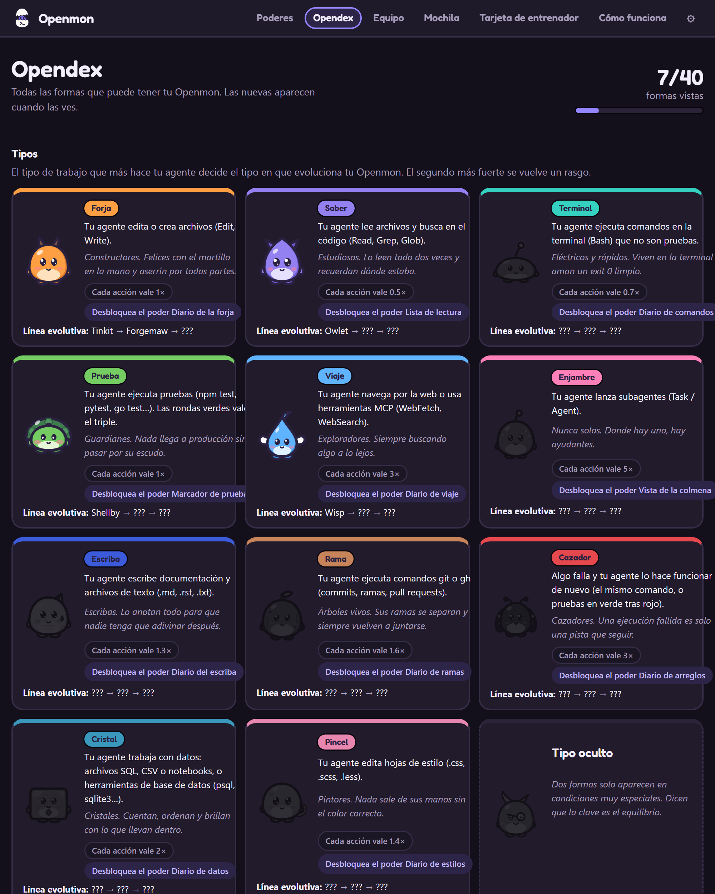
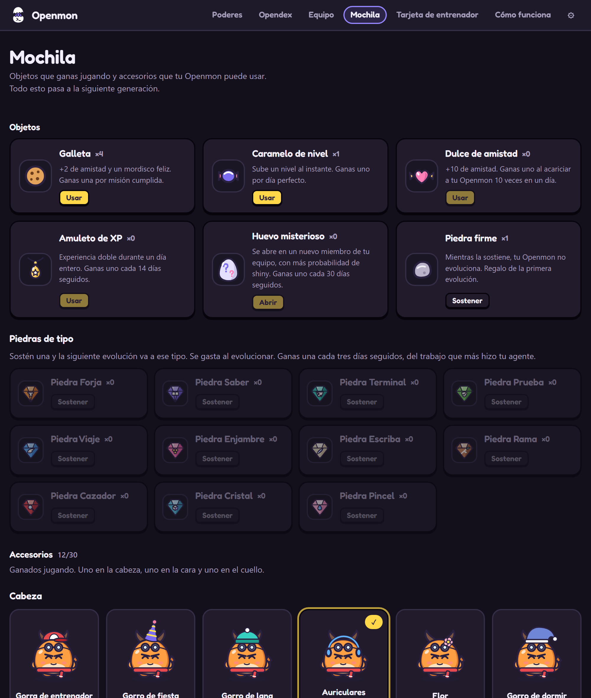
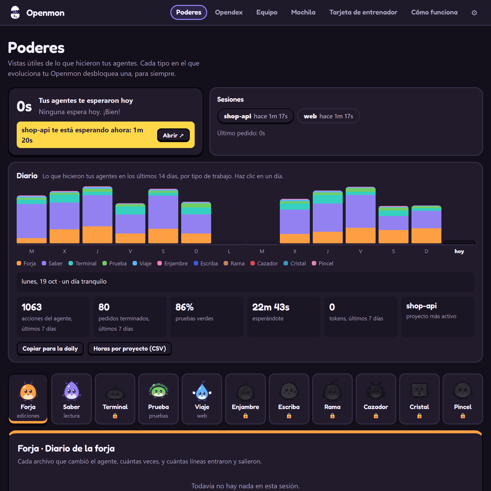

# Openmon

[Português](README.md) | [English](README.en.md) | **Español**

**Tu agente de IA trabaja. Una criatura en la esquina de la pantalla muestra lo que está haciendo, te avisa cuando te necesita y crece con cada tarea.**


Openmon es una mascota de escritorio, en el espíritu de los juegos de criaturas y de las mascotas virtuales, que vive en la esquina de la pantalla mientras Claude Code trabaja. Lee cuando el agente lee, martillea cuando el agente edita, levanta un escudo cuando corren las pruebas y salta con un cartel cuando el agente **te necesita**. Un clic en ella y la ventana del agente pasa al frente, lista para que apruebes o respondas. Con los días, el huevo eclosiona, crece y evoluciona a una de 40 formas, según el tipo de trabajo que más hace tu agente.

## Lo que hace por ti

* **Te avisa cuando el agente te necesita.** Pedido de permiso o pregunta: salta con un cartel, muestra el proyecto y el pedido en palabras simples ("Pide permiso para ejecutar un comando: npm publish") y suena un aviso suave. Si no miras, llega una notificación.
* **Te deja responder ahí mismo (opcional).** Activa "Responder permisos desde la mascota" en la configuración y el globo gana **Permitir** y **Rechazar**. Claude Code espera tu respuesta en la mascota hasta 25 segundos; después pregunta como siempre. Desactivado por defecto.
* **Te lleva directo al agente.** Un clic en la mascota, en el globo o en la notificación trae al frente la ventana donde corre el agente: terminal, VS Code o la app de Claude.
* **Muestra lo que pasa, sin mirar la terminal.** Martillo es editar, libro es leer, escudo es probar, catalejo es web. ¿Varios agentes a la vez? La tarjeta lista cada uno, con lo que está haciendo.
* **Resume cada tarea.** Cuando el agente termina: "shop-api terminó ✓ · 3 archivos · 12 comandos · pruebas ✓ · 2m 10s".
* **Lleva un diario.** Lo que hicieron tus agentes cada día, por tipo de trabajo y por proyecto, y cuánto tiempo te esperaron.
* **No molesta y no sale de tu computadora.** Los clics atraviesan la ventana, nunca bloquea ni retrasa al agente, no usa internet ni cuenta (salvo que actives el aviso en el celular o GitHub), y las contraseñas y claves aparecen ocultas (`•••`).
* **No se pierde.** Hace copias en Documentos/Openmon Backups. ¿Formateaste la PC? En una instalación nueva pregunta si quieres traerla de vuelta.
* **Va contigo a otra computadora (opcional).** Inicia sesión con GitHub (`openmon login` o Ajustes → Computadora) y tu mascota queda guardada en un Gist secreto de tu cuenta. En otra computadora, inicia sesión con la misma cuenta y sigue donde la dejaste. Si cambió en las dos, Openmon pregunta cuál conservar. Sin servidor de Openmon: la app habla directo con GitHub.

## Cómo se ve en la práctica

> **Tú:** arregla las pruebas del checkout
>
> **Claude:** lee los archivos, edita dos y pide ejecutar `npm publish`.
>
> **Openmon:** lee un libro, toma el martillo, levanta el escudo… y salta con el cartel: **"shop-api te necesita · Pide permiso para ejecutar un comando: npm publish"**. Haces clic en ella, aparece la ventana de Claude, apruebas. Celebra: **"¡Terminó! · 2 archivos · pruebas ✓"**, y gana experiencia.

<table>
<tr>
<td width="50%" align="center"><br><sub>Cuando el agente te necesita</sub></td>
<td width="50%" align="center"><br><sub>Clic derecho: la tarjeta con tus agentes</sub></td>
</tr>
</table>

| Lo que hace | Lo que significa |
|---|---|
| Salta con el cartel **!** | El agente espera tu permiso o respuesta. Haz clic en ella para ir allí |
| Martillo, libro, terminal, escudo, catalejo | El agente está editando, leyendo, ejecutando comandos, probando o en la web |
| Ayudantes volando alrededor | El agente llamó a otros agentes para ayudar |
| Celebra | El agente terminó: te toca |
| Hace una mueca | Algo falló, como una prueba |
| Duerme | No pasa nada desde hace unos minutos |

## Empieza en 3 pasos

**La forma más fácil:** descarga el instalador en [Releases](https://github.com/tiagocardosobezerra/openmon/releases/latest) (Windows `.exe`, macOS `.dmg` para Apple Silicon, Linux `.AppImage`), abre Openmon y haz clic en **Conectar** en el globo del huevo. Los avisos del agente corren con [Node.js](https://nodejs.org), que quien usa Claude Code ya tiene. Los instaladores aún no están firmados: en Windows, haz clic en "Más información → Ejecutar de todas formas"; en macOS, clic derecho en la app y "Abrir".

**Desde el código:**

Necesitas [Node.js](https://nodejs.org) 20 o más nuevo y [Claude Code](https://claude.com/claude-code).

### 1. Instala

```bash
git clone https://github.com/tiagocardosobezerra/openmon.git
cd openmon
npm install
npm link
```

`npm link` crea el comando `openmon`. La primera vez que la mascota se abre, Electron descarga su propio programa (unos 100 MB).

### 2. Conéctalo a Claude Code

```bash
openmon install
```

Agrega los avisos (hooks) en `~/.claude/settings.json` y guarda una copia de seguridad. Solo para un proyecto: `openmon install --settings .claude/settings.json`. ¿Lo olvidaste? El propio huevo muestra un botón **Conectar**.

### 3. Llama a tu Openmon

```bash
openmon start
```

El huevo aparece en la esquina de la pantalla y un ícono en la bandeja. Abre una conversación nueva en Claude Code y trabaja normalmente: eclosiona durante tu primera sesión. ¿Quieres verlo antes? `openmon demo`.

| Comando | Qué hace |
|---|---|
| `openmon start` / `openmon stop` | Abre o guarda la mascota |
| `openmon install` / `openmon uninstall` | Activa o desactiva los avisos de Claude Code (tu mascota queda guardada) |
| `openmon demo` | Muestra una sesión de ejemplo en un huevo desechable |
| `openmon playground` | Una mascota de pruebas con panel: mira todas las formas y escenas en minutos |
| `openmon dex` / `openmon card` | Abre la Opendex o la tarjeta de entrenador |
| `openmon name <apodo>` | Pone un apodo (`--clear` vuelve al nombre de la especie) |
| `openmon backup [archivo]` / `openmon restore <archivo\|latest>` | Hace una copia o trae una mascota de vuelta |
| `openmon login` / `openmon sync` / `openmon logout` | Lleva tu mascota entre computadoras con tu cuenta de GitHub |
| `openmon install --agent gemini\|cursor\|opencode\|aider` | Conecta Openmon a Gemini CLI, Cursor, OpenCode o Aider |
| `openmon autostart on\|off` | Abre la mascota al encender la computadora |
| `openmon stats` / `openmon status` | La mascota en la terminal / si todo está conectado |

## Cómo crece

Cada cosa que hace el agente vale **experiencia (XP)**. Con suficiente, evoluciona: huevo, brote, joven, adulto y anciano, en semanas de uso. Su **tipo** viene del trabajo que más hace el agente:

| Tipo | Viene de | Joven | Adulto | Anciano |
|---|---|---|---|---|
| Forja | editar archivos | Tinkit | Forgemaw | Archsmith |
| Saber | leer y buscar | Owlet | Scrollwyrm | Oracle |
| Terminal | ejecutar comandos | Sparkle | Voltcrab | Kernel |
| Prueba | ejecutar pruebas | Shellby | Bastion | Aegis |
| Viaje | web y herramientas MCP | Wisp | Skyfin | Wayfarer |
| Enjambre | llamar a otros agentes | Mote | Hivekin | Legion |
| Escriba | escribir documentación (.md, .rst, .txt) | Inkling | Quillmane | Archivist |
| Rama | comandos git y gh | Twiglet | Branchoak | Mergewood |
| Cazador | arreglar lo que falló | Mitey | Beetlock | Bugbane |
| Cristal | datos: SQL, CSV, notebooks, bases de datos | Cubit | Prismora | Datanaut |
| Pincel | hojas de estilo (.css, .scss) | Dabbit | Palettail | Chromancer |

El trabajo raro vale más, así que cualquier tipo puede ganar. Y hay un linaje escondido que poca gente va a encontrar: *dicen que el secreto es el equilibrio.*

* **Amistad** (0 a 100) solo sube: responde rápido al agente, acaríciala con un clic, vuelve todos los días. Llegar a Anciano pide amistad 60.
* **Personalidad**: cada huevo nace Valiente, Dormilona, Curiosa, Alegre, Tranquila o Pícara, lo que cambia cómo se mueve y lo que dice.
* **Rarezas**: 1 de cada 128 nace con colores brillantes (shiny), siempre con brillo y estrellitas alrededor; quien evoluciona de madrugada gana colores nocturnos. Cada forma tiene las 5 poses también en shiny y nocturna.
* **Evoluciones especiales**: con amistad 100 en la evolución a Anciano, Archsmith y Oracle crecen en la **forma de la amistad**; la Chimera escondida tiene colores propios para cada uno de los 15 pares de tipos.
* **Legendarios**: tres, cada uno ligado a una hazaña. *Mergeon* aparece con tu primer pull request aceptado, *Aeonbyte* después de un año de Openmon y *Zeroday* después de 100 arreglos. Entran en tu Equipo y nunca evolucionan.
* **Colores de temporada** (opcional): actívalos en la Configuración y, en febrero, octubre y diciembre, Openmon usa los colores de la época.
* **Forma de foco**: en un pedido largo (50 acciones o más), crece dentro de un anillo de energía hasta que el pedido termina.
* **Apodo**: sin apodo usa el nombre de la especie. Al eclosionar, pregunta si quieres ponerle uno.
* Nunca muere, nunca se enferma y nunca pierde lo que ganó.

<table>
<tr>
<td width="50%"><br><sub><b>Opendex</b>: los tipos, cómo se gana cada uno y las 40 formas</sub></td>
<td width="50%"><br><sub><b>Mochila</b>: objetos y accesorios para usar</sub></td>
</tr>
</table>

## Un Openmon por proyecto

Cada proyecto en el que el agente trabaja bastante gana **su propio huevo**. Hasta 6 van en el **Equipo**; los demás esperan en la **Caja**, con 12 fondos para elegir. Hasta 3 pueden estar en pantalla a la vez: en el Equipo, usa "También en pantalla"; cada uno muestra lo que hace el agente de su proyecto. Cada uno crece solo con el trabajo de su proyecto, y la Mochila, la Opendex y las insignias son tuyas, de entrenador, y valen para todos. En la página **Equipo** eliges quién está en pantalla, o activas "Mostrar el Openmon del proyecto en el que trabaja el agente". Las carpetas temporales (la carpeta temporal del sistema o el área de borrador de una app) no cuentan como proyecto. Todo trabajo sin un Openmon propio en el Equipo (carpeta temporal, proyecto nuevo, mascota descansando en la Caja) entrena al **Openmon principal**, el de la pantalla: para entrenar un huevo, hazlo el principal. En la Caja descansan y no ganan XP.

**Formas regionales**: un Openmon criado sobre todo en un lenguaje evoluciona con los colores de esa región y una pequeña marca: *Llaves* (JavaScript/TypeScript), *Serpiente* (Python), *Óxido* (Rust), *Corriente* (Go), *Grano* (Java/Kotlin) y *Sostenido* (C#/.NET). La Opendex registra las que viste.

## Todos los días hay algo

* **Misiones**: tres por día, como "responder al agente en menos de 30 s, 3 veces" o "3 rondas de pruebas en verde". Cada una da experiencia, amistad y una Galleta.
* **Mochila**: *Galleta* (+2 de amistad), *Caramelo de nivel* (sube un nivel), *Dulce de amistad* (+10), *Amuleto de XP* (experiencia doble por un día), *Huevo misterioso* (eclosiona un nuevo miembro, con más probabilidad de shiny), *Piedra firme* (mientras la sostiene, no evoluciona) y 11 *Piedras de tipo* (sostén una y la próxima evolución va hacia ese tipo).
* **30 accesorios** en la cabeza, la cara y el cuello: gorra, corona, bufanda, gafas redondas y de sol, monóculo, máscara de héroe, casco de obra, corona de hojas, sombrero de explorador, gorro de chef, lazo, tiara de estrellas, sombrero de calabaza, gorro de Navidad, corbata, collar de perlas, capa, cascabel, mochilita y otros, cada uno ganado con un logro (100 commits, 50 arreglos, 200 páginas leídas…). Aparecen en la mascota, en la Mochila y en la tarjeta de entrenador.
* **Regalo del día y racha**: una Galleta por día de uso, una Piedra de tipo cada 3 días seguidos, un Caramelo de nivel cada 7, un Amuleto de XP cada 14 y un Huevo misterioso cada 30.
* **Opendex, insignias y Salón de la Fama**: cuando el tuyo llega a Anciano, retíralo al Salón de la Fama y empieza una nueva generación; la Mochila, la Opendex y las insignias se quedan.

## Poderes: utilidades que libera la evolución

Cada tipo al que evoluciona tu Openmon libera, para siempre, un panel útil sobre las sesiones del agente:

| Poder | Tipo | Muestra |
|---|---|---|
| Diario de la forja | Forja | cada archivo cambiado, cuántas veces, líneas que entraron y salieron |
| Lista de lectura | Saber | lo que el agente leyó y buscó antes de actuar |
| Diario de comandos | Terminal | cada comando, si salió bien, cuánto tardó, con botón para copiar |
| Marcador de pruebas | Prueba | cada ronda de pruebas y la racha de verdes |
| Diario de viaje | Viaje | páginas abiertas, búsquedas web y herramientas MCP |
| Vista de la colmena | Enjambre | los agentes ayudantes, cuáles siguen corriendo y cuánto tardaron |
| Diario del escriba | Escriba | cada documento escrito, líneas que entraron y salieron |
| Diario de ramas | Rama | cada comando git y gh, y cuántos commits |
| Diario de arreglos | Cazador | lo que falló y volvió a funcionar, en cuántos intentos y cuánto tiempo |
| Diario de datos | Cristal | archivos de datos leídos o cambiados y cada comando de base de datos |
| Diario de estilos | Pincel | cada hoja de estilo cambiada, líneas que entraron y salieron |

Para todos: el **Diario** de los últimos 14 días y el **contador de espera**, cuánto tiempo te esperaron hoy tus agentes.



## Utilidades del día a día

**Avisos que ahorran tiempo**
* **Parece trabado**: en medio de una tarea, sin ninguna herramienta corriendo y sin nada nuevo desde hace 4 minutos. Un clic te lleva al agente.
* **Sigue corriendo**: un comando (pruebas, build) que corre hace más de 8 minutos.
* **En bucle**: la misma falla 3 veces seguidas.
* **Comando peligroso**: `rm -rf`, `git push --force`, `git reset --hard`, `DROP TABLE`, `curl … | sh` y parecidos ponen el pedido de permiso en **rojo**.
* **Commit**: 30 ediciones en 45 minutos sin commit ganan un recordatorio amable.
* **Conversación larga**: avisa cuando Claude resume la conversación para seguir.
* **Pruebas de vuelta en verde**: celebra cuando pruebas que fallaban vuelven a pasar.

**Responder sin dejar lo que haces**
* **Permitir, Permitir siempre y Rechazar** en el globo (desactivado por defecto). "Permitir siempre" aplica la regla que el propio Claude Code sugiere para ese pedido.
* **¿Varios agentes esperando?** La tarjeta muestra los botones debajo de cada uno.
* **Atajos**: `Ctrl+Alt+O` abre la tarjeta, `Ctrl+Alt+J` te lleva al agente que espera.

**Números de tu trabajo**
* **Tokens** usados hoy (en la tarjeta) y por día (en el Diario), leídos de los archivos de conversación del propio Claude Code, en tu computadora.
* **Ayer en una línea** en el primer uso del día.
* **Texto para la daily**: un botón en el Diario copia "último día de trabajo" y "hoy" listos para pegar.
* **Horas por proyecto (CSV)**: tiempo de trabajo del agente por proyecto y día, para tu hoja de horas.
* **Línea de tiempo** de cada sesión y **búsqueda** en todas ("¿en qué sesión tocó el agente cart.ts?").

**Para tu día**
* **Modo foco** (25, 50 o 90 minutos): solo aparece "te necesita"; al final, una sugerencia de pausa.
* **Recordatorio de pausa** después de 50 o 90 minutos seguidos de trabajo.
* **Modo presentación**: cambia los nombres de proyecto por "Proyecto A, B…" y oculta los comandos en todo lo que muestra Openmon, para compartir pantalla.
* **Aviso en el celular** (opcional, con la app gratuita ntfy): si un agente espera desde hace un rato, llega un aviso. Solo envía "Tu agente te necesita".
* **En OBS**: la mascota con fondo transparente para transmisiones (la dirección está en la página de Configuración).

## Para ir más allá

### Configuración

Haz clic derecho en la mascota y en **Más**, al pie de la tarjeta (o en el ícono de la bandeja). El menú tiene la tarjeta, las páginas, el **modo foco**, el **modo silencio** y la **Configuración**, una página con seis secciones:

* **Mascota**: apodo, tamaño, idioma, colores de temporada, sonidos, frases, pasear por la pantalla y mostrar el Openmon del proyecto activo.
* **Avisos**: notificación del sistema y responder permisos desde la mascota (con el tiempo de espera).
* **Foco y calma**: modo foco, modo silencio, modo presentación y recordatorio de pausa.
* **Celular**: aviso en el celular con la app ntfy (opcional).
* **Computadora**: iniciar con la computadora, conectar Claude Code, tu mascota en cualquier computadora (cuenta de GitHub), copias de la mascota (hacer ahora, exportar, traer de un archivo) y devolver la mascota a la esquina.
* **Avanzado**: atajos de teclado, OBS y demostración.

### Tu arte

Las 40 formas vienen en arte vectorial oficial (`art/official`), con poses, versiones brillantes y nocturnas. Para cambiarlas, pon imágenes con el nombre de la forma (`craft-adult.png`, `craft-adult.shiny@sleep.svg`…) en `~/.openmon/art`. La guía está en [docs/ART-PACKS.md](docs/ART-PACKS.md). `OPENMON_CLASSIC=1` vuelve al arte dibujado en código.

### Otros agentes

* **Gemini CLI**: `openmon install --agent gemini`. Muestra herramientas, pruebas, fin de tarea y pedidos de permiso.
* **Cursor**: `openmon install --agent cursor`. Muestra herramientas, pruebas y fin de tarea (Cursor no avisa cuando te espera).
* **OpenCode**: `openmon install --agent opencode` instala un plugin que muestra herramientas, fin de tarea y pedidos de permiso.
* **Aider**: `openmon install --agent aider` muestra el comando para iniciar Aider con el aviso de "te toca".
* **Codex CLI**: `openmon codex` muestra la línea para pegar en `~/.codex/config.toml`. Codex solo avisa las tareas terminadas, así que la mascota celebra y crece, pero no muestra las herramientas.
* **Cualquier otro**: envía un POST a `http://127.0.0.1:4747/event` con `{"_agent":"signal","session":"mi-agente","kind":"tool-done","family":"craft"}`. Los tipos están en [`src/classify.js`](src/classify.js).

<details>
<summary><strong>Cómo funciona por dentro (código)</strong></summary>

```
Claude Code ──hook (async)──▶ src/hook.js ──POST /event──▶ daemon (127.0.0.1:4747)
                                                             │ classify → sessions → pet
                                                             ▼                       │
                               ventana de la mascota / navegador / OBS ◀── SSE /stream └─▶ ~/.openmon/pet.json
```

* [`classify.js`](src/classify.js): convierte el aviso del agente en una señal pequeña.
* [`sessions.js`](src/sessions.js): el estado de cada conversación y la pose que más importa.
* [`pet.js`](src/pet.js): XP, amistad, evolución, misiones, objetos y accesorios, como funciones puras.
* [`focus.js`](src/focus.js): encuentra la ventana del agente y la trae al frente.
* [`backup.js`](src/backup.js): las copias en Documentos y la vuelta en una instalación nueva.
* [`public/art.js`](public/art.js): dibuja el arte oficial, con ojos que parpadean y accesorios en su lugar.

El servidor solo escucha en `127.0.0.1` y rechaza pedidos de otras páginas web (verificación de Origin y Host). El hook nunca imprime nada, siempre sale con 0 y se rinde en hasta 1,5 s. `openmon start` corre la mascota con un supervisor que la trae de vuelta en dos segundos si se cae.

</details>

## Cómo funciona por dentro


1. **El agente avisa.** Claude Code, Gemini CLI, Cursor, OpenCode y Aider ya avisan cada paso que dan (hooks). Openmon solo escucha, sin bloquear nada.
2. **Se vuelve señal.** Un servidor local en `127.0.0.1:4747` convierte cada aviso en una señal simple: herramienta usada, prueba en verde o en rojo, "te necesita".
3. **La mascota decide.** Elige la pose, gana experiencia en el tipo de trabajo correcto y anota lo que hizo el agente en los Poderes.
4. **Aparece en pantalla.** Todo queda en la esquina de tu pantalla. Nada sale de tu computadora (el aviso en el celular y GitHub son opcionales: uno solo envía "Tu agente te necesita", el otro guarda tu mascota en un Gist secreto de tu cuenta).

## Desarrollar

```bash
npm install
npm test          # node:test, sin dependencias extra
npm run smoke     # abre todas las páginas en Electron oculto y falla ante cualquier error
npm run serve     # después abre http://127.0.0.1:4747/?preview
npm start         # la mascota de escritorio
```

Diseño, principios y próximos pasos: [docs/DESIGN.md](docs/DESIGN.md). Historial de revisiones: [docs/REVIEW-LOG.md](docs/REVIEW-LOG.md).

## Licencia

MIT. Openmon es un proyecto independiente, con criaturas y arte originales.
