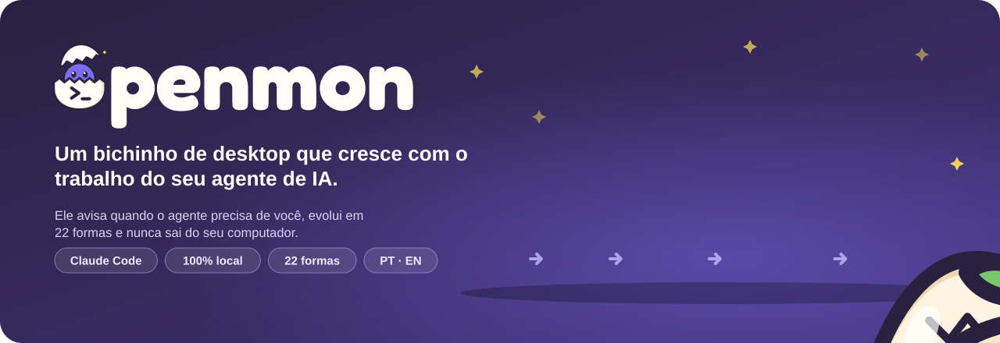
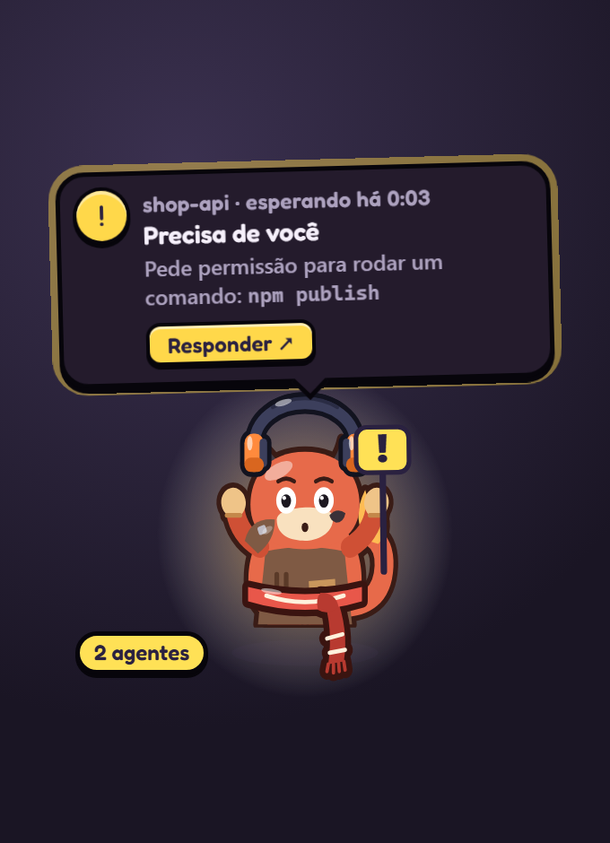
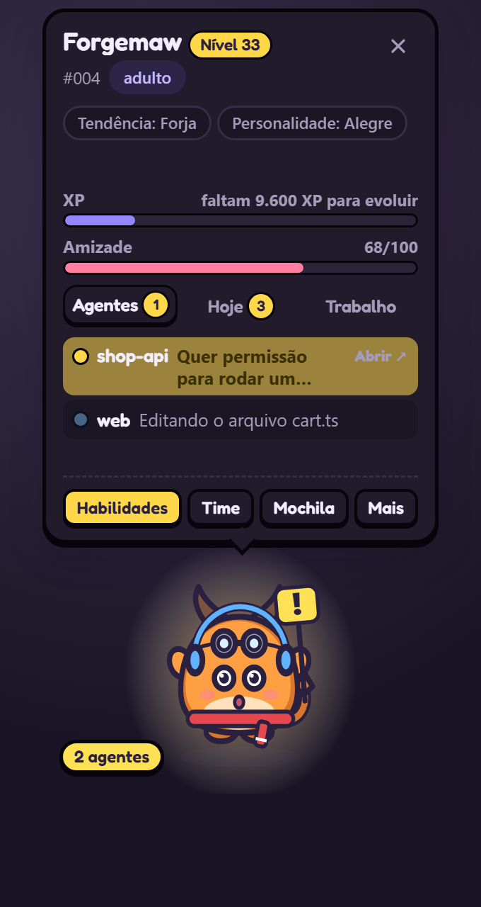
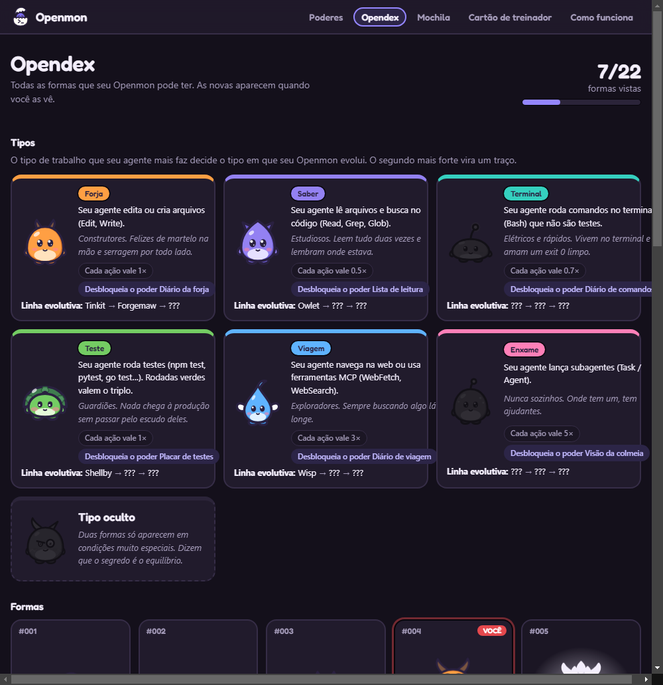
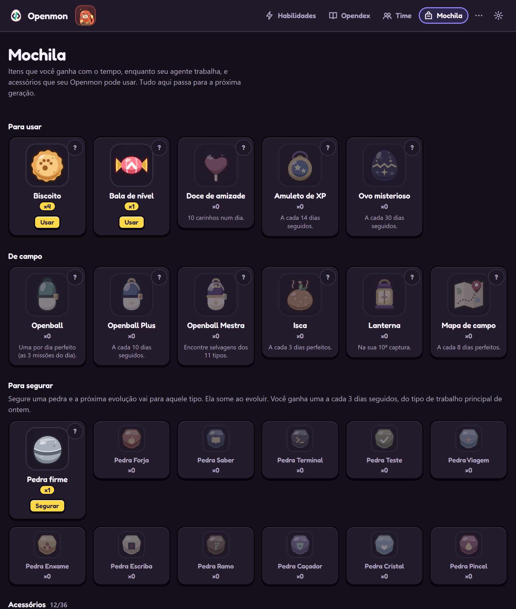
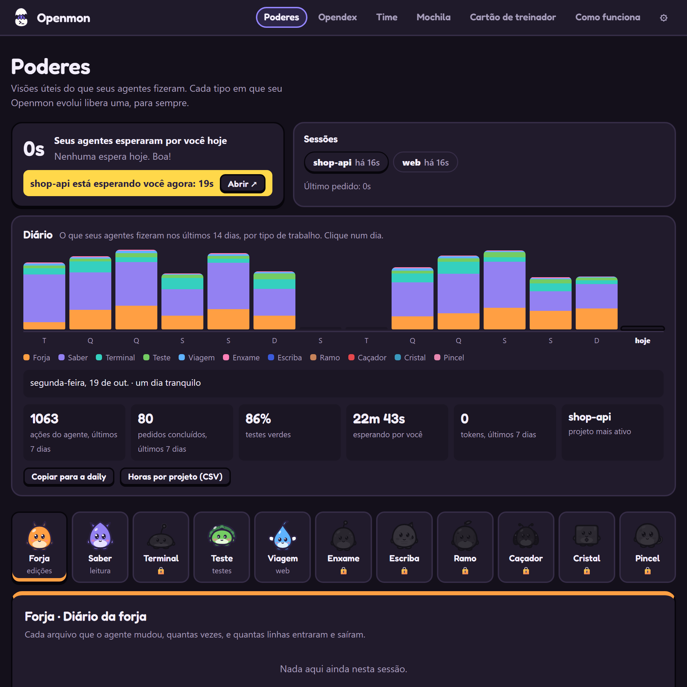

# Openmon

**Português** | [English](README.en.md) | [Español](README.es.md)

**Seu agente de IA trabalha. Um bichinho no canto da tela mostra o que ele está fazendo, avisa quando ele precisa de você e cresce com cada tarefa.**




O Openmon é um pet de desktop, no espírito dos jogos de criaturas e dos bichinhos virtuais, que vive no canto da tela enquanto o Claude Code trabalha. Ele lê quando o agente lê, martela quando o agente edita, levanta um escudo quando os testes rodam e pula segurando uma placa quando o agente **precisa de você**. Um clique nele e a janela do agente vem para a frente, pronta para você aprovar ou responder. Com os dias, o ovo choca, cresce e evolui para uma de 40 formas, decidida pelo tipo de trabalho que o seu agente mais faz.

## O que ele faz por você

* **Avisa quando o agente precisa de você.** Pedido de permissão ou pergunta: ele pula com uma placa, mostra o projeto e o pedido em palavras simples ("Quer permissão para rodar um comando: npm publish") e toca um som leve. Se você não olhar, chega uma notificação.
* **Deixa você responder ali mesmo (opcional).** Ligue "Responder permissões pelo pet" nas configurações e o balão ganha **Permitir** e **Recusar**. O Claude Code espera sua resposta no pet por até 25 segundos; depois disso ele pergunta como sempre. Desligado por padrão.
* **Leva você direto ao agente.** Um clique no pet, no balão ou na notificação traz para a frente a janela onde o agente roda: terminal, VS Code ou o app do Claude.
* **Mostra o que está acontecendo, sem você olhar o terminal.** Martelo é editar, livro é ler, escudo é testar, luneta é web. Vários agentes ao mesmo tempo? O card lista cada um, com o que está fazendo.
* **Resume cada tarefa.** Quando o agente termina: "shop-api terminou ✓ · 3 arquivos · 12 comandos · testes ✓ · 2m 10s".
* **Guarda um diário.** O que seus agentes fizeram em cada dia, por tipo de trabalho e por projeto, e quanto tempo esperaram por você.
* **Não atrapalha e não sai do seu computador.** Os cliques passam através da janela, ele nunca bloqueia nem atrasa o agente, não usa internet nem conta (a não ser que você ligue o aviso no celular ou o GitHub), e senhas e chaves aparecem escondidas (`•••`).
* **Não se perde.** Ele faz cópias em Documentos/Openmon Backups. Formatou o PC? Numa instalação nova ele pergunta se você quer trazê-lo de volta.
* **Vai com você para outro computador (opcional).** Entre com o GitHub (`openmon login` ou Configurações → Computador) e seu pet fica salvo num Gist secreto da sua conta. Em outro computador, entre com a mesma conta e ele continua de onde parou. Se ele mudou nos dois, o Openmon pergunta qual manter. Sem servidor do Openmon: o app fala direto com o GitHub.

## Como fica na prática

> **Você:** corrige os testes do checkout
>
> **Claude:** lê os arquivos, edita dois deles e pede para rodar `npm publish`.
>
> **O Openmon:** lê um livro, pega o martelo, levanta o escudo… e pula com a placa: **"shop-api precisa de você · Quer permissão para rodar um comando: npm publish"**. Você clica nele, a janela do Claude aparece, você aprova. Ele comemora: **"Terminou! · 2 arquivos · testes ✓"**, e ganha experiência.

<table>
<tr>
<td width="50%" align="center"><br><sub>Quando o agente precisa de você</sub></td>
<td width="50%" align="center"><br><sub>Botão direito: o card com seus agentes</sub></td>
</tr>
</table>

| O que ele faz | O que significa |
|---|---|
| Pula segurando a placa **!** | O agente espera sua permissão ou resposta. Clique nele para ir até lá |
| Martelo, livro, terminal, escudo, luneta | O agente está editando, lendo, rodando comandos, testando ou na web |
| Ajudantes voando em volta | O agente chamou outros agentes para ajudar |
| Comemora | O agente terminou: sua vez |
| Faz careta | Algo falhou, como um teste |
| Dorme | Nada acontece há alguns minutos |

## Comece em 3 passos

**Jeito mais fácil:** baixe o instalador em [Releases](https://github.com/tiagocardosobezerra/openmon/releases/latest) (Windows `.exe`, macOS `.dmg` para Apple Silicon, Linux `.AppImage`), abra o Openmon e clique em **Conectar** no balão do ovo. Os avisos do agente rodam com o [Node.js](https://nodejs.org), que quem usa o Claude Code já tem. Os instaladores ainda não são assinados: no Windows, clique em "Mais informações → Executar assim mesmo"; no macOS, clique com o botão direito no app e em "Abrir".

**Pelo código:**

Você precisa do [Node.js](https://nodejs.org) 20 ou mais novo e do [Claude Code](https://claude.com/claude-code).

### 1. Instale

```bash
git clone https://github.com/tiagocardosobezerra/openmon.git
cd openmon
npm install
npm link
```

O `npm link` cria o comando `openmon`. O npm 11 pode pedir para você aprovar o script de instalação do Electron: `npm install-scripts approve electron`.

### 2. Ligue no Claude Code

```bash
openmon install
```

Adiciona os avisos (hooks) em `~/.claude/settings.json` e guarda um backup. Só para um projeto: `openmon install --settings .claude/settings.json`. Esqueceu? O próprio ovo mostra um botão **Conectar**.

### 3. Chame seu Openmon

```bash
openmon start
```

O ovo aparece no canto da tela e um ícone surge na bandeja. Abra uma conversa nova no Claude Code e trabalhe normalmente: ele choca durante a sua primeira sessão. Quer ver antes? `openmon demo`.

| Comando | O que faz |
|---|---|
| `openmon start` / `openmon stop` | Abre ou guarda o pet |
| `openmon install` / `openmon uninstall` | Liga ou desliga os avisos do Claude Code (seu pet fica guardado) |
| `openmon demo` | Mostra uma sessão de exemplo num ovo descartável |
| `openmon playground` | Um pet de testes com painel: veja todas as formas e cenas em minutos |
| `openmon dex` / `openmon card` | Abre a Opendex ou o cartão de treinador |
| `openmon name <apelido>` | Dá um apelido (`--clear` volta ao nome da espécie) |
| `openmon backup [arquivo]` / `openmon restore <arquivo\|latest>` | Faz uma cópia ou traz um pet de volta |
| `openmon login` / `openmon sync` / `openmon logout` | Leva seu pet entre computadores pela sua conta do GitHub |
| `openmon install --agent gemini\|cursor\|opencode\|aider` | Liga o Openmon no Gemini CLI, Cursor, OpenCode ou Aider |
| `openmon autostart on\|off` | Abre o pet quando você liga o computador |
| `openmon stats` / `openmon status` | O pet no terminal / se está tudo ligado |

## Como ele cresce

Cada coisa que o agente faz vale **experiência (XP)**. Com o bastante, ele evolui: ovo, broto, jovem, adulto e mítico, em semanas de uso. O **tipo** dele vem do trabalho que o agente mais faz:

| Tipo | Vem de | Jovem | Adulto | Mítico |
|---|---|---|---|---|
| Forja | editar arquivos | Tinkit | Forgemaw | Archsmith |
| Saber | ler e buscar | Owlet | Scrollwyrm | Oracle |
| Terminal | rodar comandos | Sparkle | Voltcrab | Kernel |
| Teste | rodar testes | Shellby | Bastion | Aegis |
| Viagem | web e ferramentas MCP | Wisp | Skyfin | Wayfarer |
| Enxame | chamar outros agentes | Mote | Hivekin | Legion |
| Escriba | escrever documentação (.md, .rst, .txt) | Inkling | Quillmane | Archivist |
| Ramo | comandos git e gh | Twiglet | Branchoak | Mergewood |
| Caçador | consertar o que falhou | Mitey | Beetlock | Bugbane |
| Cristal | dados: SQL, CSV, notebooks, bancos | Cubit | Prismora | Datanaut |
| Pincel | folhas de estilo (.css, .scss) | Dabbit | Palettail | Chromancer |

Trabalho raro vale mais, então todo tipo pode vencer. E existe uma linhagem escondida que pouca gente vai achar: *dizem que o segredo é o equilíbrio.*

* **Amizade** (0 a 100) só sobe: responda rápido ao agente, faça carinho com um clique, volte todo dia. O estágio mítico pede amizade 60.
* **Personalidade**: cada ovo nasce Corajoso, Sonolento, Curioso, Alegre, Calmo ou Atrevido, o que muda como ele se mexe e o que ele fala.
* **Raridades**: 1 em 128 nasce com cores brilhantes (shiny), sempre com brilho e estrelinhas em volta; quem evolui de madrugada ganha cores noturnas. Cada forma tem as 5 poses também em shiny e noturna.
* **Evoluções especiais**: com amizade 100 na evolução mítica, Archsmith e Oracle crescem na **forma da amizade**; a hidden Chimera tem cores próprias para cada um dos 15 pares de tipos.
* **Lendários**: três, cada um ligado a um feito. *Mergeon* aparece no seu primeiro pull request aceito, *Aeonbyte* depois de um ano de Openmon e *Zeroday* depois de 100 consertos. Eles entram no seu Time e nunca evoluem.
* **Cores de época** (opcional): ligue nas Configurações e, em fevereiro, outubro e dezembro, o Openmon usa as cores da época.
* **Forma de foco**: num pedido longo (50 ações ou mais), ele cresce dentro de um anel de energia até o pedido acabar.
* **Apelido**: sem apelido ele usa o nome da espécie. Ao chocar, ele pergunta se você quer dar um.
* Ele nunca morre, nunca adoece e nunca perde o que conquistou.

<table>
<tr>
<td width="50%"><br><sub><b>Opendex</b>: os tipos, como cada um se conquista e as 40 formas</sub></td>
<td width="50%"><br><sub><b>Mochila</b>: itens e acessórios para usar</sub></td>
</tr>
</table>

## Um Openmon por projeto

Cada projeto em que o agente trabalha bastante ganha **o seu próprio ovo**. Até 6 andam no **Time**; os outros esperam na **Caixa**, com 12 papéis de parede para escolher. Até 3 podem ficar na tela ao mesmo tempo: no Time, use "Também na tela"; cada um mostra o que o agente do seu projeto está fazendo. Cada um cresce só com o trabalho do seu projeto, e a Mochila, a Opendex e as insígnias são suas, de treinador, e valem para todos. Na página **Time** você escolhe quem fica na tela, ou liga "Mostrar o Openmon do projeto em que o agente está trabalhando". Pastas temporárias (a pasta temporária do sistema ou a área de rascunho de um app) não contam como projeto: o trabalho nelas vai para o seu primeiro Openmon.

**Formas regionais**: um Openmon criado principalmente numa linguagem evolui com as cores daquela região e uma pequena marca: *Chaves* (JavaScript/TypeScript), *Serpente* (Python), *Ferrugem* (Rust), *Correnteza* (Go), *Grão* (Java/Kotlin) e *Sustenido* (C#/.NET). A Opendex registra as que você viu.

## Todo dia tem algo

* **Missões**: três por dia, como "responder ao agente em até 30 s, 3 vezes" ou "3 rodadas de testes verdes". Cada uma dá experiência, amizade e um Biscoito.
* **Mochila**: *Biscoito* (+2 de amizade), *Bala de nível* (sobe um nível), *Doce de amizade* (+10), *Amuleto de XP* (experiência em dobro por um dia), *Ovo misterioso* (choca um novo membro, com mais chance de shiny), *Pedra firme* (enquanto ele segura, não evolui) e 11 *Pedras de tipo* (segure uma e a próxima evolução vai para aquele tipo).
* **30 acessórios** na cabeça, no rosto e no pescoço: boné, coroa, cachecol, óculos redondos e escuros, monóculo, máscara de herói, capacete de obra, coroa de folhas, chapéu de explorador, gorro de chef, laço, tiara de estrelas, chapéu de abóbora, gorro de Natal, gravata, colar de pérolas, capa, sininho, mochilinha e outros, cada um liberado por uma conquista (100 commits, 50 consertos, 200 páginas lidas…). Aparecem no pet, na Mochila e no cartão de treinador.
* **Presente do dia e sequência**: um Biscoito por dia de uso, uma Pedra de tipo a cada 3 dias seguidos, uma Bala de nível a cada 7, um Amuleto de XP a cada 14 e um Ovo misterioso a cada 30.
* **Opendex, insígnias e Hall da Fama**: quando o seu chega ao mítico, aposente-o no Hall da Fama e comece uma nova geração; a Mochila, a Opendex e as insígnias continuam.

## Poderes: utilidades que a evolução libera

Cada tipo em que seu Openmon evolui libera, para sempre, um painel útil sobre as sessões do agente:

| Poder | Tipo | Mostra |
|---|---|---|
| Diário da forja | Forja | cada arquivo alterado, quantas vezes, linhas que entraram e saíram |
| Lista de leitura | Saber | o que o agente leu e buscou antes de agir |
| Diário de comandos | Terminal | cada comando, se deu certo, quanto tempo levou, com botão de copiar |
| Placar de testes | Teste | cada rodada de testes e a sequência de verdes |
| Diário de viagem | Viagem | páginas abertas, buscas na web e ferramentas MCP |
| Visão da colmeia | Enxame | os agentes ajudantes, quais ainda rodam e quanto levaram |
| Diário do escriba | Escriba | cada documento escrito, linhas que entraram e saíram |
| Diário dos ramos | Ramo | cada comando git e gh, e quantos commits |
| Diário de consertos | Caçador | o que falhou e voltou a funcionar, em quantas tentativas e quanto tempo |
| Diário de dados | Cristal | arquivos de dados lidos ou mudados e cada comando de banco |
| Diário de estilos | Pincel | cada folha de estilo alterada, linhas que entraram e saíram |

Para todo mundo: o **Diário** dos últimos 14 dias e o **contador de espera**, quanto tempo seus agentes esperaram por você hoje.



## Utilidades do dia a dia

**Avisos que poupam tempo**
* **Parece travado**: no meio de uma tarefa, sem nenhuma ferramenta rodando e nada acontecendo há 4 minutos. Um clique leva ao agente.
* **Ainda rodando**: um comando (testes, build) rodando há mais de 8 minutos.
* **Em loop**: a mesma falha 3 vezes seguidas.
* **Comando perigoso**: `rm -rf`, `git push --force`, `git reset --hard`, `DROP TABLE`, `curl … | sh` e parecidos deixam o pedido de permissão **vermelho**.
* **Commit**: 30 edições em 45 minutos sem commit ganham um lembrete gentil.
* **Conversa longa**: avisa quando o Claude resume a conversa para continuar.
* **Testes de volta ao verde**: comemora quando testes que falhavam voltam a passar.

**Responder sem sair do que está fazendo**
* **Permitir, Sempre permitir e Recusar** no balão (desligado por padrão). "Sempre permitir" aplica a regra que o próprio Claude Code sugere para aquele pedido.
* **Vários agentes esperando?** O card mostra os botões embaixo de cada um.
* **Atalhos**: `Ctrl+Alt+O` abre o card, `Ctrl+Alt+J` leva ao agente que espera.

**Números do seu trabalho**
* **Tokens** usados hoje (no card) e por dia (no Diário), lidos dos arquivos de conversa do próprio Claude Code, no seu computador.
* **Ontem em uma linha** no primeiro uso do dia.
* **Texto para a daily**: um botão no Diário copia "último dia de trabalho" e "hoje" prontos para colar.
* **Horas por projeto (CSV)**: tempo de trabalho do agente por projeto e dia, para planilha de horas.
* **Linha do tempo** de cada sessão e **busca** em todas ("em que sessão o agente mexeu em cart.ts?").

**Para o seu dia**
* **Modo foco** (25, 50 ou 90 minutos): só "precisa de você" aparece; no fim, uma sugestão de pausa.
* **Lembrete de pausa** depois de 50 ou 90 minutos seguidos de trabalho.
* **Modo apresentação**: troca nomes de projeto por "Projeto A, B…" e esconde comandos em tudo o que o Openmon mostra, para compartilhar a tela.
* **Aviso no celular** (opcional, via app gratuito ntfy): se um agente espera há um tempo, chega um aviso. Manda só "Seu agente precisa de você".
* **No OBS**: o pet com fundo transparente para lives (endereço na página de Configurações).

## Para ir além

### Configurações

Clique com o botão direito no pet e na engrenagem do card (ou no ícone da bandeja). O menu tem o card, as páginas, o **modo foco**, o **modo silencioso** e as **Configurações**, uma página com seis seções:

* **Pet**: apelido, tamanho, idioma, cores de época, sons, falas, passear pela tela e mostrar o Openmon do projeto ativo.
* **Avisos**: notificação do sistema e responder permissões pelo pet (com o tempo de espera).
* **Foco e calma**: modo foco, modo silencioso, modo apresentação e lembrete de pausa.
* **Celular**: aviso no celular pelo app ntfy (opcional).
* **Computador**: iniciar com o computador, conectar o Claude Code, seu pet em qualquer computador (conta do GitHub), cópias do pet (fazer agora, exportar, trazer de um arquivo) e voltar o pet ao canto da tela.
* **Avançado**: atalhos de teclado, OBS e demonstração.

### Sua arte

As 40 formas vêm em arte vetorial oficial (`art/official`), com poses, versões brilhantes e noturnas. Para trocar, coloque imagens com o nome da forma (`craft-adult.png`, `craft-adult.shiny@sleep.svg`…) em `~/.openmon/art`. O guia está em [docs/ART-PACKS.md](docs/ART-PACKS.md). `OPENMON_CLASSIC=1` volta para a arte desenhada em código.

### Outros agentes

* **Gemini CLI**: `openmon install --agent gemini`. Mostra ferramentas, testes, fim de tarefa e pedidos de permissão.
* **Cursor**: `openmon install --agent cursor`. Mostra ferramentas, testes e fim de tarefa (o Cursor não avisa quando espera por você).
* **OpenCode**: `openmon install --agent opencode` instala um plugin que mostra ferramentas, fim de tarefa e pedidos de permissão.
* **Aider**: `openmon install --agent aider` mostra o comando para iniciar o Aider com aviso de "sua vez".
* **Codex CLI**: `openmon codex` mostra a linha para colar em `~/.codex/config.toml`. O Codex só avisa tarefas terminadas, então o pet comemora e cresce, mas não mostra as ferramentas.
* **Qualquer outro**: mande um POST para `http://127.0.0.1:4747/event` com `{"_agent":"signal","session":"meu-agente","kind":"tool-done","family":"craft"}`. Os tipos estão em [`src/classify.js`](src/classify.js).

<details>
<summary><strong>Como funciona por dentro</strong></summary>

```
Claude Code ──hook (async)──▶ src/hook.js ──POST /event──▶ daemon (127.0.0.1:4747)
                                                             │ classify → sessions → pet
                                                             ▼                       │
                                     janela do pet / navegador / OBS ◀── SSE /stream └─▶ ~/.openmon/pet.json
```

* [`classify.js`](src/classify.js): transforma o aviso do agente num sinal pequeno.
* [`sessions.js`](src/sessions.js): o estado de cada conversa e a pose que mais importa.
* [`pet.js`](src/pet.js): XP, amizade, evolução, missões, itens e acessórios, como funções puras.
* [`focus.js`](src/focus.js): acha e traz para a frente a janela do agente.
* [`backup.js`](src/backup.js): as cópias em Documentos e a volta numa instalação nova.
* [`public/art.js`](public/art.js): desenha a arte oficial, com olhos que piscam e acessórios no lugar certo.

O servidor só escuta em `127.0.0.1` e recusa pedidos de outras páginas da web (checagem de Origin e Host). O hook nunca imprime nada, sempre sai com 0 e desiste em até 1,5 s. `openmon start` roda o pet com um supervisor que o traz de volta em dois segundos se ele cair.

</details>

## Como funciona por dentro



1. **O agente avisa.** Claude Code, Gemini CLI, Cursor, OpenCode e Aider já avisam cada passo que dão (hooks). O Openmon só escuta, sem bloquear nada.
2. **Vira sinal.** Um servidor local em `127.0.0.1:4747` transforma cada aviso em um sinal simples: ferramenta usada, teste verde ou vermelho, "precisa de você".
3. **O pet decide.** Ele escolhe a pose, ganha experiência no tipo de trabalho certo e anota o que o agente fez nos Poderes.
4. **Aparece na tela.** Tudo fica no canto da sua tela. Nada sai do seu computador (o aviso no celular e o GitHub são opcionais: um manda só "Seu agente precisa de você", o outro guarda seu pet num Gist secreto da sua conta).

## Desenvolver

```bash
npm install
npm test          # node:test, sem dependências extras
npm run smoke     # abre todas as páginas no Electron escondido e falha em qualquer erro
npm run serve     # depois abra http://127.0.0.1:4747/?preview
npm start         # o pet de desktop
```

Design, princípios e próximos passos: [docs/DESIGN.md](docs/DESIGN.md). Histórico das revisões: [docs/REVIEW-LOG.md](docs/REVIEW-LOG.md).

## Licença

MIT. Openmon é um projeto independente, com criaturas e arte originais.
