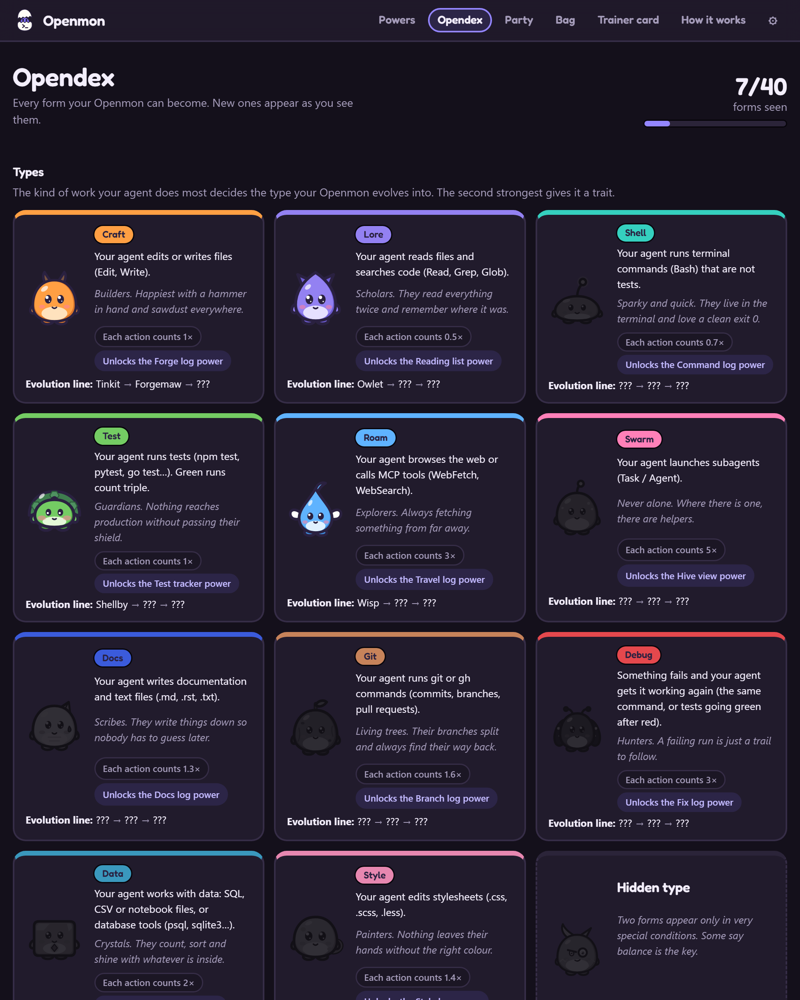
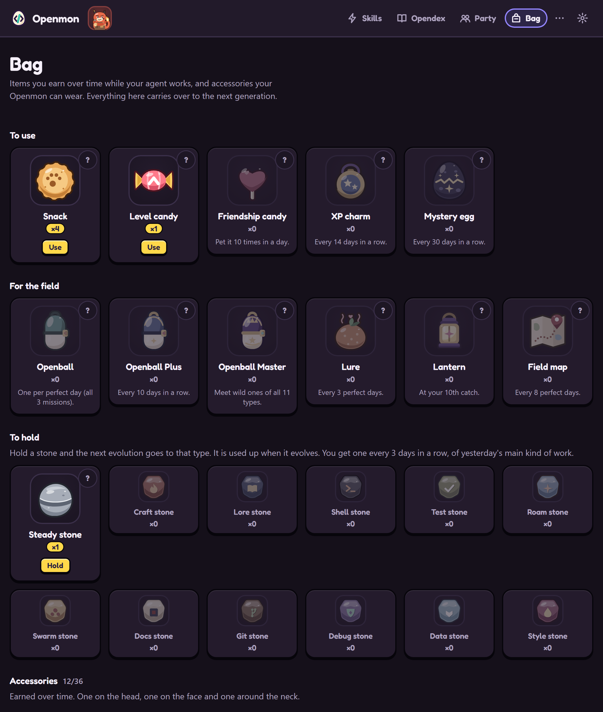
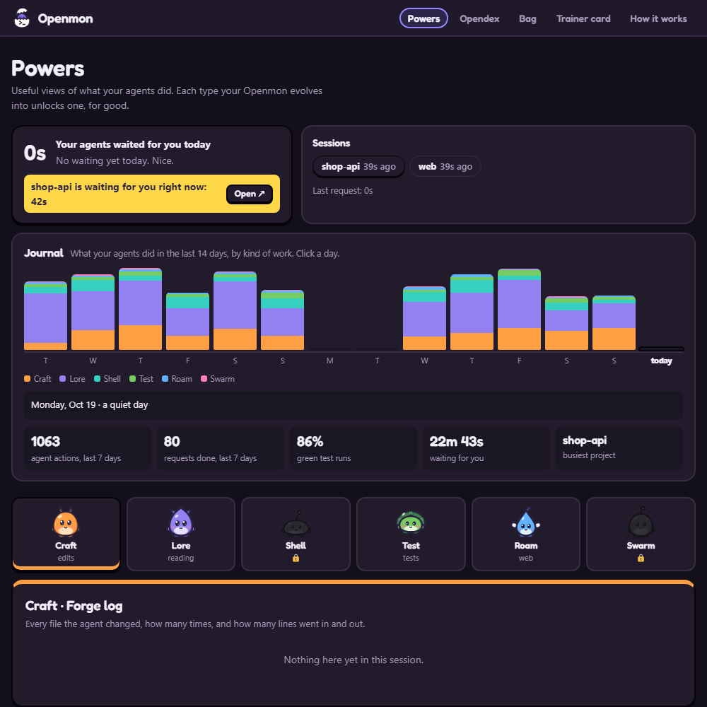

# The Openmon game

[Português](GAME.md) | **English** | [Español](GAME.es.md)

Openmon is a desktop pet, in the spirit of creature-collecting games and virtual pets, that lives in the corner of your screen while Claude Code works. It reads when your agent reads, hammers when it edits, raises a shield when the tests run, and jumps holding a sign when the agent **needs you**. Click it and the agent's window comes to the front, ready for you to approve or reply. Over the days, the egg hatches, grows and evolves into one of 40 forms, decided by the kind of work your agent does most.

This page explains the game. For what Openmon does for you and how to install it, see the [README](../README.en.md).

## How it grows

Everything your agent does is worth **experience (XP)**. With enough, it evolves: egg, juvenile, adult and elder, over weeks of use. The egg hatches straight into the juvenile of the **type** your agent's work decides:

| Type | Comes from | Juvenile | Adult | Elder |
|---|---|---|---|---|
| Craft | editing files | Tinkit | Forgemaw | Archsmith |
| Lore | reading and searching | Owlet | Scrollwyrm | Oracle |
| Shell | running commands | Sparkle | Voltcrab | Kernel |
| Test | running tests | Shellby | Bastion | Aegis |
| Roam | the web and MCP tools | Wisp | Skyfin | Wayfarer |
| Swarm | calling other agents | Mote | Hivekin | Legion |
| Docs | writing documentation (.md, .rst, .txt) | Inkling | Quillmane | Archivist |
| Git | git and gh commands | Twiglet | Branchoak | Mergewood |
| Debug | fixing what failed | Mitey | Beetlock | Bugbane |
| Data | data: SQL, CSV, notebooks, databases | Cubit | Prismora | Datanaut |
| Style | stylesheets (.css, .scss) | Dabbit | Palettail | Chromancer |

**You choose your first Openmon.** The first egg, and the egg of every new generation, lets you pick one of three starters, the three most common kinds of agent work: **Tinkit** (Craft), **Owlet** (Lore) and **Sparkle** (Shell). It hatches after a few minutes of work, with its type's Skill already unlocked, and keeps that type for life: it becomes the same lineage's Adult and Elder, and all XP counts. A type stone can still redirect the next evolution. Every other egg (project eggs and mystery eggs) hatches into the type of the work, at 400 XP.

Rare work counts more, so every type can win. And there is a hidden line few will find: *some say balance is the key.*

* **Friendship** (0 to 100) only goes up: answer your agent quickly, pet it with a click, come back every day. Becoming an Elder asks for friendship 60.
* **Personality**: every egg is born Brave, Sleepy, Curious, Cheerful, Calm or Cheeky, which changes how it moves and what it says.
* **Rarities**: 1 in 128 hatches in shiny colours, always with a glow and little stars around it. Every form has its 5 poses in shiny colours too.
* **Hidden line**: when two kinds of work are almost exactly tied, the Chimera appears.
* **Legendaries**: three, each tied to a feat. *Mergeon* appears when your first pull request is merged, *Aeonbyte* after a year of Openmon and *Zeroday* after 100 fixes. They join your Party and never evolve.
* **Wild encounters**: now and then (1 in 1,024 agent actions, at most one a day) a wild Openmon shows up next to your pet for 10 minutes. It is always a Juvenile, almost always of the type of the action that called it, and it can be shiny (1 in 128). Throw an *Openball* to try to catch it: 3 in 4. If it breaks free, half the time it stays for another try. Caught, it joins your Party with no project and keeps its type. You get 3 Openballs with your first Openmon, one per perfect day and one every 5 days in a row. You can turn them off in Settings.
* **Focus form**: during a long request (50 actions or more) it grows inside a ring of energy until the request ends.
* **Nickname**: without one it goes by its species name. When it hatches, it asks whether you want to give it one.
* It never dies, never gets sick and never loses what it earned.

<table>
<tr>
<td width="50%"> <b>Opendex</b>: the types, how to get each one and the 40 forms</td>
<td width="50%"> <b>Bag</b>: items and accessories to wear</td>
</tr>
</table>

## One Openmon per project

Every project your agent works on enough gets **its own egg**. Up to 6 travel in your **Party**; the rest wait in the **Nest**, with 12 wallpapers to pick from. Up to 3 can be on screen at once: on the Party page, use "Also on screen"; each one shows what its own project's agent is doing. Each one grows only from its project's work, while the Bag, Opendex and badges belong to you as a trainer and count for all of them. On the **Party** page you pick who is on screen and what each one follows. Temporary folders (the system temp folder or an app's scratch workspace) are not projects. Any work without its own Openmon in the Party (a temporary folder, a new project, a pet resting in the Nest) trains the **main Openmon**, the one on screen: to train an egg, make it the main one. With more than one Openmon on screen, each agent session without a pet of its own goes to one of them, the one with the fewest sessions, and stays with it: that pet earns its XP and shows it on its card. In the Nest, pets rest and earn no XP.

**Who follows what.** Who follows each conversation, in this order: 1) a conversation you pinned to an Openmon (right-click → Agents → click the pet's name next to the conversation); 2) a project you pinned to an Openmon (Party → "Follows"); 3) the project's own Openmon, while it is in the Party; 4) the queue: with more than one on screen, each new conversation goes to one of them, in turn. In Settings → Pet you can turn sharing off; then everything stays with the main one, except what you pinned. In the Nest, pets rest and earn no XP.

**Talking to your agent through the pet.** The pet is your point of contact with the conversation it follows, not only an alert. With Claude Code: on a permission request, **Allow**, **Always allow**, **Deny** or **Explain…** (deny with a reason the agent reads, or deny and stop); on a question from the agent, its options become buttons and **Other…** lets you write your own answer; and **Message** (on the "All done!" bubble or in the card) sends a note to the conversation: an idle agent wakes up right away, a working one gets it with its next step. Nothing is ever approved on its own, text only goes out when you click Send, and only the desktop app can write to the agent. With the other agents (Codex, Gemini CLI, Cursor, OpenCode, Aider), a click on the pet still takes you to the agent's window.

## Something every day

* **Missions**: three a day, like "answer your agent within 30 s, 3 times" or "3 green test runs". Each gives experience, friendship and a Snack.
* **Bag**: *Snack* (+2 friendship), *Level candy* (one level up), *Friendship candy* (+10), *XP charm* (double experience for a day), *Mystery egg* (hatches a new member, with better shiny odds), *Steady stone* (while it holds it, it does not evolve) and 11 *Type stones* (hold one and the next evolution goes to that type).
* **30 accessories** for the head, face and neck: cap, crown, scarf, round glasses, sunglasses, monocle, hero mask, hard hat, leaf crown, explorer hat, chef hat, ribbon bow, star tiara, pumpkin hat, Santa hat, necktie, pearl necklace, cape, little bell, little backpack and more, each unlocked by an achievement (100 commits, 50 fixes, 200 pages read…). They show on the pet, in the Bag and on the trainer card.
* **Daily gift and streak**: a Snack per day of use, a Type stone every 3 days in a row, a Level candy every 7, an XP charm every 14 and a Mystery egg every 30.
* **Opendex, badges and Hall of Fame**: once yours becomes an Elder, retire it to the Hall of Fame and start a new generation, picking a starter again; the Bag, Opendex and badges carry over.

## Skills: tools that evolution unlocks

Each type your Openmon evolves into unlocks, for good, a useful panel about your agent's sessions:

| Power | Type | Shows |
|---|---|---|
| Forge log | Craft | every file changed, how many times, lines added and removed |
| Reading list | Lore | what the agent read and searched before acting |
| Command log | Shell | every command, whether it worked, how long it took, with a copy button |
| Test tracker | Test | every test run and the green streak |
| Travel log | Roam | pages opened, web searches and MCP tools |
| Hive view | Swarm | the helper agents, which still run and how long they took |
| Docs log | Docs | every document written, lines in and out |
| Branch log | Git | every git and gh command, and how many commits |
| Fix log | Debug | what failed and worked again, in how many tries and how long |
| Data log | Data | data files read or changed and every database command |
| Style log | Style | every stylesheet changed, lines in and out |

For everyone: the **Journal** of the last 14 days and the **waiting counter**, how long your agents waited for you today.

